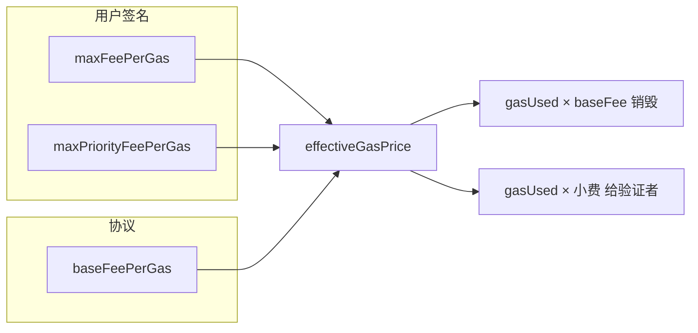
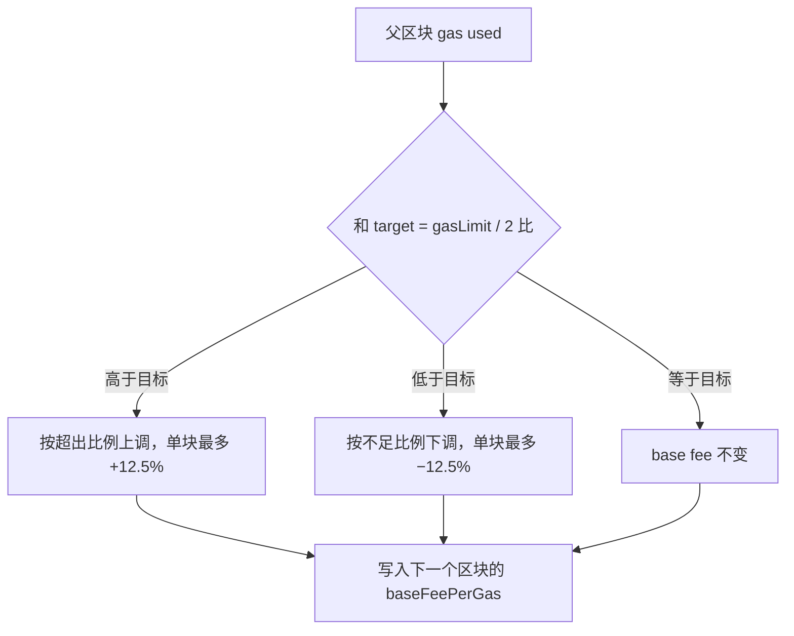

# EIP-1559：Gas Fee 与 Base Fee

EIP-1559 在伦敦硬分叉（2021-08-05，主网区块 12,965,000）改了以太坊的手续费。用户不再只报一个 `gasPrice` 去跟别人抢打包，而是协议先定一个全网统一的 **base fee**，用户再另付一笔给验证者的 **priority fee（小费）**。Base fee 被销毁，不进验证者口袋。

官方参考：[EIP-1559](https://eips.ethereum.org/EIPS/eip-1559)、[ethereum.org：Gas and fees](https://ethereum.org/developers/docs/gas/)。

---

## 旧方案怎么算，问题在哪

伦敦之前是**第一价格拍卖（first-price auction）**。

用户在交易里写一个 `gasPrice`（每单位 gas 愿意付多少 wei）。打包者按出价从高到低塞满区块。成交后，这笔交易**按自己的出价付钱**，全部归打包者：

```text
fee = gasUsed × gasPrice
```

`gasUsed` 是执行实际烧掉的 gas，`gasPrice` 是用户签名时写死的单价。队列里比你低的出价不影响你付多少。

这套规则有四个结构性问题。

**出价没有公开牌价。** 协议不告诉你「下一笔大概要多少」。钱包只能看最近几个区块的成交价再加缓冲。估低了，交易挂在 mempool 里不动；估高了，多出来的部分照单全收。拥堵时钱包会把缓冲拉得很大，用户系统性多付。

**付的是自己的报价，不是出清价。** 第一价格拍卖里，理性出价要猜别人会出多少，再在那之上加一点。猜错就亏。假如当时能进块的价格是 40 gwei，你为了保险写了 100 gwei，打包后仍按 100 gwei 结算，多出来的 60 gwei 全部给矿工。

**区块是硬顶，费用就会跳。** 旧区块有一个 gas 上限（伦敦前长期约 1500 万），用满就不能再塞。需求只比供给高一点点时，区块已经 100% 满，出价从「能进」变成「必须压过队尾」，gas price 会在几个区块里冲很高，需求一退又掉下来。没有中间档：要么没满、费用很低，要么满了、费用失控。

**一个字段同时表示两件事。** `gasPrice` 既是「我最多付多少」，也是「我实际付给打包者多少」。费用全部进矿工余额，用户无法把协议价格和小费拆开。只要行情一变，整笔报价都要重签。

结果是：费用难估、波动大、同样一笔转账在相邻区块的花费可以差很多。钱包只能用「故意出高价」来换确认速度。

---

## EIP-1559 把费用拆成两截

一笔类型 2 交易（`0x02`，dynamic fee transaction）里，和费用相关的是两个上限，都由用户签名：

| 字段 | 含义 |
| --- | --- |
| `maxFeePerGas` | 每单位 gas 最多付多少，含 base fee 和小费 |
| `maxPriorityFeePerGas` | 每单位 gas 最多给验证者多少小费 |

协议另外给每个区块写死一个 `baseFeePerGas`，用户不能在交易里指定它。进块的硬条件是：

```text
maxFeePerGas >= baseFeePerGas
maxPriorityFeePerGas <= maxFeePerGas
```

实际成交单价取「你的总上限」和「当前 base fee + 小费上限」里较小的那个：

```text
effectiveGasPrice = min(maxFeePerGas, baseFeePerGas + maxPriorityFeePerGas)
```

然后按实际消耗的 gas 拆账：

```text
总支出     = gasUsed × effectiveGasPrice
销毁       = gasUsed × baseFeePerGas
验证者小费 = gasUsed × (effectiveGasPrice − baseFeePerGas)
```

`maxFeePerGas` 高于成交单价的部分不收。发送前会按 `gasLimit × maxFeePerGas` 冻结余额，执行结束后把没用完的 gas、以及成交价低于上限的差价退回。

三个常见情况：

| 你签的参数 | 当前 base fee | 成交单价 | 谁拿到什么 |
| --- | --- | --- | --- |
| maxFee 50，小费上限 2 | 30 | 32 | 销毁 30，小费 2 |
| maxFee 31，小费上限 2 | 30 | 31 | 销毁 30，小费只剩 1（被总上限卡住） |
| maxFee 25，小费上限 2 | 30 | 不能进块 | `maxFee < baseFee`，交易无效 |

用一笔普通转账（`gasUsed = 21000`）对一下第一种：

```text
base fee      = 30 gwei
小费上限      = 2 gwei
maxFeePerGas  = 50 gwei
成交单价      = min(50, 30 + 2) = 32 gwei

总支出 = 21000 × 32 gwei = 672,000 gwei = 0.000672 ETH
销毁   = 21000 × 30 gwei = 630,000 gwei = 0.000630 ETH
小费   = 21000 × 2 gwei  =  42,000 gwei = 0.000042 ETH
```

签名上限是 50 gwei，实际只按 32 gwei 付。多出来的 18 gwei 不会被收走。

旧交易（legacy，以及带 access list 的 type 1）仍然有效。它们只有一个 `gasPrice`，协议把它同时当作 `maxFeePerGas` 和 `maxPriorityFeePerGas`：

```text
effectiveGasPrice = gasPrice          （前提是 gasPrice >= baseFee）
小费              = gasPrice − baseFee
```

因此 legacy 交易在 base fee 下跌时，差价会全部变成验证者小费，不能把「最多付多少」和「只给这么多小费」分开。新钱包应发 type 2。



小费仍然是一场小拍卖：base fee 相同的交易里，验证者会优先打包小费更高的。平时 1–2 gwei 就够；只有区块持续打满、很多人的 `maxFeePerGas` 都远高于 base fee 时，小费才会被炒上去。跟着需求走的是 base fee。

---

## Base fee 怎么跟着上一个区块调整

Base fee 不是投票投出来的，也不是预言机。它由**父区块用了多少 gas** 按公式算出来，写进子区块头。所有客户端用同一套整数运算，对不上就分叉。

两个协议常数：

| 常数 | 值 | 作用 |
| --- | --- | --- |
| `ELASTICITY_MULTIPLIER` | 2 | 目标用量 = 父区块 gas limit ÷ 2。区块最多还能装到 gas limit，也就是目标的 2 倍 |
| `BASE_FEE_MAX_CHANGE_DENOMINATOR` | 8 | 单个区块最多把 base fee 推高或压低 1/8，即 12.5% |

伦敦激活时初始 `baseFeePerGas = 1 gwei`（`1_000_000_000` wei）。当时客户端把 gas limit 从约 1500 万翻到约 3000 万，使**目标用量仍约 1500 万**。之后验证者可以继续投票改 gas limit，目标始终是父区块 gas limit 的一半，调整公式不变。

设父区块的 base fee 为 `b`，gas limit 为 `L`，实际用气为 `g`：

```text
target = L / 2          # 整数除法
```

父区块刚好打在目标上时，子区块 base fee 不变。用超了就涨，没用满就跌。EIP-1559 的参考实现是：

```python
def calc_base_fee(parent_base_fee, parent_gas_used, parent_gas_limit):
    target = parent_gas_limit // 2

    if parent_gas_used == target:
        return parent_base_fee

    if parent_gas_used > target:
        delta = parent_gas_used - target
        # 至少涨 1 wei，避免 base fee 在低位被整除卡死
        change = max(parent_base_fee * delta // target // 8, 1)
        return parent_base_fee + change

    delta = target - parent_gas_used
    change = parent_base_fee * delta // target // 8
    return max(parent_base_fee - change, 0)
```

满块和空块是两个极端。`g = L = 2 × target` 时：

```text
change = b × target / target / 8 = b / 8
新 base fee = b × 1.125
```

`g = 0` 时同样是 `b / 8`，新 base fee 为 `b × 0.875`。所以无论需求怎么跳，下一区块的 base fee 相对上一区块的变动不超过 ±12.5%。连续每个区块都打满时，大约 6 个区块（约 72 秒）翻一倍，大约 20 个区块（约 4 分钟）变成 10 倍。钱包可以据此给 `maxFeePerGas` 留几个区块的上涨空间，而不必像旧方案那样盲猜一个拍卖价。

中间用量按偏离目标的比例线性缩放。`b = 100 gwei`、`target = 15_000_000` 时：

| 父区块 gas used | 相对目标 | 变化 | 下一区块 base fee |
| --- | --- | --- | --- |
| 15,000,000 | 0% | 0 | 100 gwei |
| 22,500,000 | +50% | +6.25% | 106.25 gwei |
| 30,000,000 | +100%（打满） | +12.5% | 112.5 gwei |
| 7,500,000 | −50% | −6.25% | 93.75 gwei |
| 0 | −100% | −12.5% | 87.5 gwei |

涨的时候如果整除结果是 0，公式强制至少 +1 wei，base fee 在极低数值下仍能往上爬。跌的时候可以跌到 0，没有强制最小降幅。

长期看，这个控制器把平均用量拉向目标。连续高于目标，base fee 按复利上升，直到愿意付这个价钱的需求回到目标附近；连续低于目标则下降，把需求吸引回来。弹性容量（目标是 gas limit 的一半，短时可以打满）用来吸收突发流量，避免每一次小拥堵都变成费用尖峰。



---

## 和旧方案对照

| | 伦敦之前 | EIP-1559 |
| --- | --- | --- |
| 用户填写 | 一个 `gasPrice` | `maxFeePerGas` + `maxPriorityFeePerGas` |
| 实际单价 | 永远等于报价 | `min(maxFee, baseFee + 小费上限)` |
| 钱给谁 | 全部给矿工 | base fee 销毁，只有小费给验证者 |
| 协议牌价 | 没有 | 每个区块头里的 `baseFeePerGas` |
| 下一区块费用能变多少 | 没有上限，拍卖说了算 | 相对上一块最多 ±12.5% |
| 区块用量 | 顶在 gas limit，满了就垂直涨价 | 目标是 gas limit 的一半，允许短暂打满 |
| 估费错了 | 出高了就多付，出低了就卡住 | 出高了按成交价收，只是多锁一点余额；出低到 `maxFee < baseFee` 才进不去 |

销毁不改变「这笔交易要花多少」的计算，它改变的是 ETH 的流向：拥堵越严重，烧掉的 base fee 越多。验证者仍靠小费和区块奖励排序、打包，但不能把 base fee 装进自己的余额。
