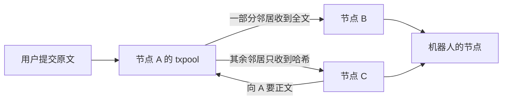
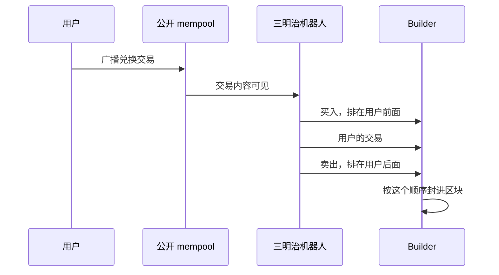
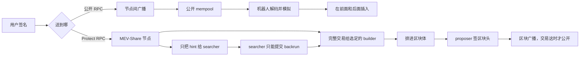
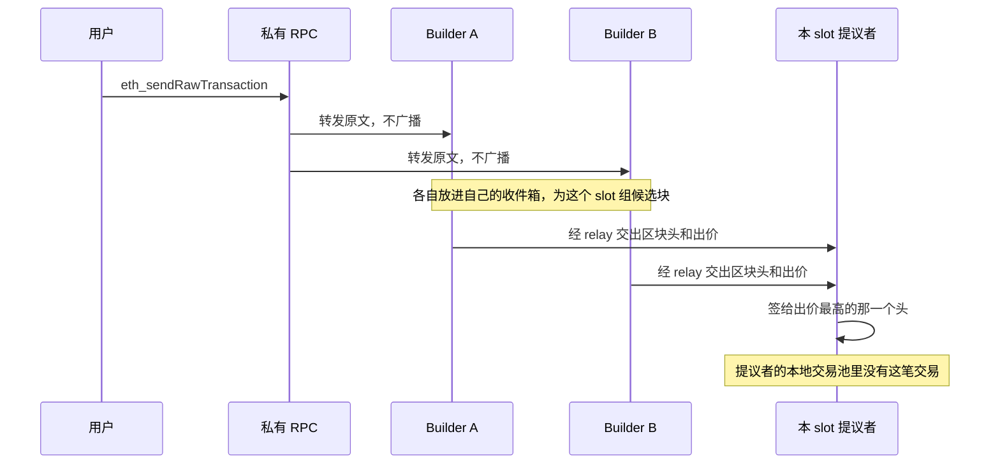

# Flashbots 私有交易：不进公开 mempool

抢跑靠的是「交易还没上链，内容已经被人看见，而且还能插到它前面」。Flashbots Protect 改的是第一件事：签名后的交易不在公开 mempool 里广播。三明治机器人从公开队列里看不到它，就排不进它前面。

交易格式没有变。变的是投递路径，以及谁在区块密封之前读得到 calldata。

官方参考：[Flashbots Protect Quick Start](https://docs.flashbots.net/flashbots-protect/quick-start)、[Settings Guide](https://docs.flashbots.net/flashbots-protect/settings-guide)、[`eth_sendPrivateTransaction`](https://docs.flashbots.net/flashbots-protect/additional-documentation/eth-sendPrivateTransaction)、[MEV-Share](https://docs.flashbots.net/flashbots-mev-share/introduction)、[mev-boost](https://docs.flashbots.net/flashbots-mev-boost/introduction)、[ethereum.org：MEV](https://ethereum.org/developers/docs/mev/)、[devp2p eth 协议](https://github.com/ethereum/devp2p/blob/master/caps/eth.md)。

---

## 公开 mempool：每台节点一份，靠互相转发重叠

公开 mempool 不是全网共用的一个队列，也没有一个中心服务器在收交易。每台执行客户端（Geth、Reth、Nethermind、Besu）内存里有自己的 **txpool**：已经校验过、还没进块的已签名交易。你连上一个 RPC，查到的「pending」就是那一台机器当时手里的那一份。

这些本地池子会长得差不多，是因为节点之间会把交易转发出去。协议在 devp2p 的 `eth` 能力里。一笔交易从用户手里出发，要经过好几跳，才会出现在一个机器人自己的节点上。



用户调用 `eth_sendRawTransaction`，交给的是某一台节点。那台节点先在本地验收，再放进自己的池子，然后告诉邻居。邻居再告诉自己的邻居。这就是「互相广播」：每一跳只发给自己连着的对等节点，通常几十个，不是一次发给全网所有人。

Geth 为了省带宽，不会把全文推给每一个邻居。大约 `sqrt(邻居数)` 个邻居直接收到 `Transactions` 消息，里面是完整的已签名交易。其余邻居收到 `NewPooledTransactionHashes`，只有哈希、交易类型和字节长度。对方池子里没有这笔，就回一个 `GetPooledTransactions` 把正文要回去。别的客户端也是「先通知、再按需取正文」这一类做法，份数可以不同。取到正文、校验通过之后，这台节点把交易放进自己的 txpool，并继续向外讲。几跳之后，监听公开网络的节点几乎都有一份。传播通常是亚秒到一两秒，远短于 12 秒的一个 slot。

广播出去的是签过名的原始交易。`to`、`value`、`data`、gas 上限、`maxFeePerGas`、`maxPriorityFeePerGas`、`nonce` 都是明文。`from` 可以从签名恢复出来。这一层没有加密。任何人运行一个节点，或者订一个会推送 pending 交易的 RPC，都能在进块之前把 calldata 解出来，在本地模拟「如果它按某个顺序执行会怎样」。

节点收到一笔交易时做的事可以收成这样：

```text
function onRawTx(rawTx):
    tx = decode(rawTx)
    require signature recovers a sender
    require tx.nonce >= account.nonce          # 比已上链 nonce 还小的是旧交易
    require balance covers value + max gas
    require tx.maxFeePerGas >= current base fee
    if txpool.has(tx.hash):
        return
    if txpool.has(sender, tx.nonce) and feeBump(tx) < replaceBump:
        reject                                  # Geth 默认要加价约 10% 才能替换同一 nonce
    txpool.add(tx)
    gossip(tx)

function gossip(tx):
    peers = connectedPeers()
    direct = randomSubset(peers, about sqrt(len(peers)))
    for peer in direct:
        send(peer, Transactions[tx])            # 全文
    for peer in peers except direct:
        send(peer, NewPooledTransactionHashes[tx.hash, tx.type, tx.size])

function onHashAnnounce(peer, hash):
    if txpool.has(hash):
        return
    send(peer, GetPooledTransactions[hash])     # 要到正文后走 onRawTx，再继续向外讲
```

池子内部还有两格，别把它想成一条按到达顺序排列的队伍：

| | 什么时候在这里 | 组块时能不能直接拿来执行 |
| --- | --- | --- |
| pending | 这个地址的 nonce 正好接在已上链 nonce 后面，中间没有空档 | 能。builder 从这里挑 |
| queued | nonce 超前，前面还有没出现的交易 | 不能。前面的 nonce 到了才升到 pending |

同一个地址可以有多笔连续 nonce。池子按地址、再按 nonce 排，不按谁先广播到。池子满了会丢掉出价太低的；同一 nonce 的新交易要加价够多才替换旧的。这些规则只决定「留不留在这台机器的内存里」。哪一笔进下一个区块、排在第几位，是 builder（或自己组块的验证者）另做的决定。两台节点的到达顺序可以不一样，这不影响共识，因为共识认的是已经签过名的区块，不是 mempool。

交易离开池子，是因为包含它的区块已经到了，或者它变得不可能执行：nonce 已经被别的交易用掉、余额不够、被同 nonce 的加价交易替换、在池子里待太久、或者池子满了被挤掉。

```text
function onCanonicalBlock(block):
    execute(block)
    for tx in block.transactions:
        txpool.drop(tx.hash)
    txpool.drop(sender whose nonce is now already used)
```

公开 mempool 因此是一块候选人集合：内容在进块前就铺开了，顺序还没定。三明治机器人站在这个窗口里。防抢跑的私有 RPC 切断的就是 `gossip` 这一步，交易只进 builder 的收件箱，不进这条转发网络。

---

## 公开路径里，三明治排在哪

机器人订一个节点的 pending 交易，解码 `to` 和 `data`，在本地把交易跑一遍，算出「如果我插在它前面，能赚多少」。

合并之后，一个区块里的顺序由 **builder** 决定，不再是矿工按 gas price 从高到低排。Builder 把排好的区块交给 **relay**，当前 slot 的 **proposer**（验证者）选出价最高的区块头签名。签名锁定的是交易默克尔根，顺序在签名前就已经定了。走 Flashbots 的交易靠的就是这条 mev-boost 路径：builder 出块，relay 转交，proposer 签名。

三明治要的是这个签名之前的窗口：

1. 看见受害者的兑换交易还挂在 mempool 里。
2. 在它前面放一笔同方向买入，把价格打差。
3. 让受害者按更差的价格成交。
4. 在它后面卖出，把价差换成自己的利润。

计算过程参考：[三明治攻击计算过程](https://my.feishu.cn/wiki/TxeSwJ37pifDPAkL0C7cXNLFn6b)
用常量乘积池看一眼差在哪。池子有 100 ETH 和 100000 TOKEN，`k = 10_000_000`，手续费先当成 0。

用户拿 10 ETH 买 TOKEN，单独成交能拿到约 9091 TOKEN。有人先用 5 ETH 买入，池子变成 105 ETH / 95238 TOKEN。用户这 10 ETH 只能拿到约 8282 TOKEN。攻击者再把刚买到的 TOKEN 卖回，拿回约 5.97 ETH。多出来的约 0.97 ETH 来自用户少拿到的 TOKEN。用户的滑点上限越宽，这段空间越大。

攻击者的交易必须在**同一个区块、受害者前面和后面**。做不到这两次插入，价差就锁不住。



---

## 私有交易改的是投递，不是交易本身

用户照常签名一笔类型 2 交易：`to`、`data`、`value`、`maxFeePerGas`、`maxPriorityFeePerGas`、`nonce` 都在。区别只在把原始交易送到哪里。

| | 公开 RPC | Flashbots Protect |
| --- | --- | --- |
| 调用 | `eth_sendRawTransaction` 打到普通节点 | 同一笔原始交易打到 `https://rpc.flashbots.net`，或用 `eth_sendPrivateTransaction` 打到 `https://relay.flashbots.net` |
| 广播 | 节点转发给其他节点，进入公开 mempool | 不进入公开 mempool |
| 谁在上链前看见 calldata | 任何监听 mempool 的人 | MEV-Share 节点、被选中的 builder，以及按 hint 能看到的部分信息 |
| 失败交易 | 上链后回滚，gas 照付 | 默认模拟失败就不打包，用户不付这笔失败 gas |
| 没被收进区块 | 留在 mempool，继续被看见 | 默认追 25 个区块，仍未上链就丢掉。要再发，得重新提交 |

Protect 要求 **priority fee 严格大于 0**。小费为 0 的交易不会转给 builder，除非被 searcher 放进 MEV-Share bundle。

钱包把 RPC 换成 Protect 之后，发出去的仍是普通的 `eth_sendRawTransaction`。Protect 在服务端把它当成私有交易处理。读请求（余额、`eth_call`）还是普通 JSON-RPC。



上链之后 calldata 是公开的。保护期是「proposer 签名之前」。顺序已经写进区块头承诺的交易根里，公开 mempool 里的机器人插不进去。短重组理论上能把这个区块推翻再重排。PoS 上这种重组贵，而且不常见。私有交易没有把重组这件事消掉。

---

## 私有 RPC 是什么

这里有两个容易混在一起的东西。

**自己搭的执行客户端，或者买来的专属 RPC，仍然在公开网络上。** 它不跟别人共用 API 额度，读链可以更快。你对它调用 `eth_sendRawTransaction` 时，它把交易放进本地 txpool，再按 devp2p 规则转发给对等节点。几个传播周期之后，公开 mempool 里就有这笔交易。节点是「私有的」，交易池不是。

**防抢跑的私有 RPC 是一个订单流转发器。** Flashbots Protect、MEV Blocker、Blink、Merkle 都属于这一类。它对外仍是 JSON-RPC，钱包照常发 `eth_sendRawTransaction`。收到已签名交易之后，它不做全网广播，而是把原文转给一组 block builder。读请求（余额、`eth_call`、估 gas）还是代理到普通节点。这个进程自己不提议区块，也不是验证者。

所以不存在一条全网共享的「私有 mempool」。每个 builder 有自己的收件箱。私有 RPC 做的是扇出：同一笔原文同时放进你选中的那些收件箱。只发给一个 builder，就只有这个 builder 组出的区块里可能出现它。

| | 普通节点 / 公共 RPC | 防 MEV 的私有 RPC |
| --- | --- | --- |
| 它是什么 | 执行客户端，参与交易广播 | 订单流转发服务 |
| `eth_sendRawTransaction` | 进本地 txpool，再广播 | 不广播，转给选定的 builder |
| 验证者自己的 txpool | 会跟着公开广播逐渐看到 | 看不到 |
| 谁能把它打进块 | 任何看见它的 builder，以及自己组块的验证者 | 只有收件箱里有它、并且本 slot 中标的 builder |

---

## 验证者要签名，但不用看见这笔交易

PoS 里每个 slot（12 秒）选出一个提议者，由他签区块。这件事没变。变的是区块体从哪来。

跑 mev-boost 的提议者把自己组块的权利卖掉。到点之后，他的 mev-boost 边车向各个 relay 要当前最高出价。出价背后是 builder 已经装好的完整区块：公开交易、私有订单流、bundle 都在里面。提议者比较付款，签区块头。签名锁定交易根。Relay 这才放出区块体，网络开始广播。

提议者本地的 txpool 不参与这次组块。私有交易能上链，是因为它已经躺在中标 builder 的区块体里，不是因为某个验证者的 mempool 里有它。



一个 slot 在提议者这边可以收成这样：

```text
function everySlot():                 # 12 秒一次，全网恰好一个提议者
    proposer = selectByStakeAndRandao()

    if proposer.usesMevBoost:
        bids = relays.bestBids()      # 每个 bid 已经绑着一个组好的 body
        best = max(bids, by = paymentToProposer)
        proposer.sign(best.header)    # 不读自己的 txpool
        relays.publish(best.body)
        # 私有交易在 best.body 里，当且仅当组这个 body 的 builder 收到过它
    else:
        body = proposer.buildFromPublicTxpool()
        proposer.signAndBroadcast(body)
        # 私有交易不在公开池里，这个 slot 错过
```

Builder 这边每 slot 都在组块，不管自己会不会中标：

```text
function builderOnSlot(inbox):
    body = pack(
        inbox.privateTxs,       # 私有 RPC 扇出过来的
        inbox.bundles,
        publicMempool           # 另外监听来的公开交易
    )
    # 模拟失败的私有交易默认丢掉，不占 gas
    bid = paymentFrom(body)     # 用户的 priority fee 和分给验证者的回款都算在里面
    relays.submit(header(body), bid, body)
```

因此「快」指的是：接下来几个 slot 里，有没有一个中标 builder 的收件箱里有这笔交易。不是「等那个认识我的验证者轮到出块」。

写这份说明时（2026-10-28），大约九成以太坊区块由 builder 组好再卖给提议者，验证者自己用执行客户端组块的大约一成不到。来源是当天的 [OpenChainBench 24 小时统计](https://openchainbench.com/benchmarks/evm-block-builders)（本地组块一行约 8%）。私有交易错过的，主要就是这些自己组块的 slot，外加「没收到这笔交易的 builder 中了标」的 slot。

2025 年对几家私有 RPC 的对照里，同一类交易从提交到进块，MEV Blocker 平均约 1.34 个区块，Flashbots Protect 约 1.49 个区块（[Private MEV Protection RPCs](https://arxiv.org/html/2505.19708v1)）。量级是一两个 slot，也就是十几秒，不是等到某个特定验证者。

进块快慢由这几件事叠出来：

**扇出有多宽。** Protect 默认只转给 Flashbots 的 builder。那个 builder 没赢下这个 slot，交易就继续等。`/fast` 以及多写 `builder=` 会把原文交给更多 builder，下一个中标者更可能手里就有它。扇出越宽，能读到全文的打包者越多。

**小费和回款留成。** priority fee 为 0 的交易不会转给 builder。费用正常的兑换，真正决定「哪个 builder 赢」的通常是整块 MEV，不是你这一笔小费。但回款如果几乎全留给用户、分给验证者的部分太少，这个区块的出价会变低，中标变难，等待变长。

**赶不赶得上这一轮拍卖。** Builder 在 slot 末尾就要把出价交给 relay。交易到得太晚，只能进下一个 slot。`auctionTimeout` 就是把这种来晚的交易主动推迟到下一轮开头，好让 searcher 还有时间出价。

**模拟要过、区块要装得下。** 默认回滚不上链。gas 上限太低、nonce 错了、或者这个 builder 的区块已经被更高小费的交易填满，这笔就留到后面的 slot，直到 `blockRange`（默认 25）用完被丢掉。

自己组块的那一成验证者永远不会从公开池里捡到这笔交易。私有 RPC 没有把交易补进他们的 txpool。覆盖更多 builder，是在提高「中标者已经拿过原文」的概率，不是去说服下一个提议者。

---

## 三方分别看见什么

「私有」是相对公开 mempool 说的。交易没有被加密到谁都解不开。

**MEV-Share 节点看见完整交易。** 用户把原始交易交给它。它按用户的 hint 决定对外露出多少，自己留着全文，用来模拟、拼 bundle、转给 builder。

**Searcher 默认看不见全文。** 默认配置只分享 `hash` 和 `default_logs`。`default_logs` 是兑换相关日志的一小段：哪个池子发生了 swap，不是完整 calldata。Searcher 根据这些提示提交 **backrun**：紧跟在用户交易后面的套利。节点目前只接受 backrun，不接受插到用户前面的交易。

节点会模拟 searcher 交来的 bundle。模拟通过，并且用户能拿到约定比例的回款，节点才把「用户交易 + backrun」转给 builder。默认 **90% 的 backrun 价值回到 `tx.origin`**，剩下的给验证者，让这个区块在拍卖里还出得起价。Gas fee 的回款默认 100% 回到 `tx.origin`。

默认路径把两种 MEV 拆开了：

| 种类 | 做法 | Protect 默认怎么处理 |
| --- | --- | --- |
| 抢跑、三明治 | 插到用户前面，把成交价打差 | 公开机器人看不到交易。MEV-Share 不接受插在前面的 bundle |
| Backrun | 跟在用户后面，吃掉价格留下的套利 | 允许。利润按比例退给用户 |

Backrun 不改变用户这笔兑换的成交价。它赚的是用户成交之后池子偏离外部市场的那段。退款是把这段利润分回来。防三明治靠的是隐藏，退款靠的是允许 backrun。

**Builder 必须看见全文。** 它要执行交易、收 gas、把交易放进区块。默认配置只把交易转给 Flashbots 自己的 builder。多写一个 `builder` 参数，覆盖的 builder 更多，进块概率更高，同时你也多信任一个会看到全文的打包者。

Builder 技术上做得到三明治：交易在它手里，顺序由它排。共识协议不检查「这笔私有交易前面有没有一笔对敲」。挡住这件事的是订单流。专门走私有通道的钱包和用户会离开一个三明治自己客户的 builder。Fast 模式里，跑在 TEE 里的 searcher 能看到除去签名的完整交易，用来提高回款；TEE 外面的 searcher 仍然只拿 hint。这把「机器能读交易」和「操作员把交易抄出去抢跑」分开，前提是可信执行环境本身成立。

只分享 `hash` 这一个 hint，是文档里的全隐私档。Searcher 几乎无法针对内容做 backrun，回款也会少。防抢跑仍然成立，因为全文还是没进公开 mempool。

---

## 一笔交易怎么走完

下面按默认 Protect（`https://rpc.flashbots.net`）写。数字和字段名对齐文档里的默认值：追 25 个区块、hint 为 `hash` + `default_logs`、回款 90% 给 `tx.origin`、回滚交易不上链、priority fee 必须大于 0。

```text
function sendSwap(wallet, router, calldata):
    tx = sign(wallet, {
        to: router,
        data: calldata,
        maxPriorityFeePerGas: > 0,
        maxFeePerGas: baseFee 的上限,
        nonce: wallet.nonce
    })

    # 不把 tx 发给会广播的公开节点
    sendRaw(tx, "https://rpc.flashbots.net")
    return tx.hash
```

MEV-Share 节点收到后：

```text
function onPrivateTx(rawTx):
    tx = decode(rawTx)
    require tx.maxPriorityFeePerGas > 0

    if simulate(tx) reverts and not canRevert:
        drop(tx)                    # 不上链，用户不付失败 gas
        return

    deadline = latestBlock + 25     # 可用 blockRange 改
    hints = { hash: tx.hash, logs: swapLogs(simulate(tx)) }
    publishToSearchers(hints)       # 没有 calldata，没有精确的买卖数量
    remember(tx, deadline)
```

Searcher 只能交一个跟在后面的 bundle。节点把用户交易固定在前面，这是 MEV-Share 的规则，不是链上共识：

```text
function onSearcherBundle(userHash, backrunTx):
    userTx = lookup(userHash)
    require userTx != null

    # 节点只接受 backrun，顺序写成：用户在前
    ordered = [userTx, backrunTx]
    result = simulate(ordered)

    require refund(result, userTx.origin) >= 0.90 * backrunProfit(result)

    forwardToBuilders(ordered, refundRule)
```

Builder 把这笔交易和它收到的其他私有交易、公开交易、bundle 放进候选区块。Relay 校验给提议者的付款，只把区块头和出价交给当前 slot 的提议者。提议者选中并签名之后，区块体才广播。监听公开 mempool 的机器人这时第一次看见 calldata，区块里的位置已经固定。

```text
function builderLoop(slot):
    body = order(
        publicMempool,    # 里面没有这笔私有兑换
        privateTxs,       # 用户的原文在这里
        shareBundles      # 已经是 [userTx, backrun]
    )
    header = seal(body)
    bid = paymentToProposer(body)
    relay.offer(header, bid, body)

function proposer(slot):
    best = max(relay.headers, by = bid)
    signature = sign(best.header)   # 签的是含交易根的头
    relay.release(signature)        # 这时才放出 body
    broadcast(block)
```

公开 mempool 里的机器人每来一笔新交易就做的那次判断，对这笔兑换不会触发：

```text
function publicSandwichBot(pending):
    for tx in pending:                 # 来源只有公开广播
        if tx.hash == privateSwap.hash:
            # 这条分支到不了。privateSwap 没被广播
            placeAround(tx)
```

25 个区块后仍没进块，节点丢掉它。它不会自己掉进公开 mempool。同一 nonce 要成交，需要重新签名提交，或者提高费用后再发一笔私有交易替换。

---

## 和 bundle 不是同一件事

私有交易是**一笔**用户交易，目标是别在公开队列里暴露。

Bundle 是一组排好序的原始交易，原子执行：要么按这个顺序都进同一个区块，要么整组不要。Searcher 抓套利、清算、救援时用 bundle，因为策略本身也不能先出现在公开 mempool 里。MEV-Share 上 searcher 交的是不完整 bundle，节点补上用户交易，变成 `[userTx, backrun]` 再交给 builder。

用户防抢跑，走的是私有交易这条。Bundle 是节点把「用户交易和跟在后面的套利」绑成一组的工具。

| | 私有交易 | Bundle |
| --- | --- | --- |
| 里面有几笔 | 1 | 多笔，顺序固定 |
| 谁在用 | 钱包、用户、应用 | Searcher，以及要原子落地的救援 |
| 失败了 | 默认整笔不打包 | 可标记哪些交易允许回滚，其余必须成功 |
| 防三明治的原因 | 公开 mempool 没有它 | 顺序由提交者写死，外人插不进这组的中间 |

---

## Protect 上几个会改变保护效果的开关

查询参数写在 RPC URL 上。没写的项用默认值。指定了 hint 之后，没点名的 hint 就关掉。

| 开关 | 默认 | 改了以后 |
| --- | --- | --- |
| 入口 | `https://rpc.flashbots.net` | `/fast` 把交易发给全部已注册 builder，验证者分到的 MEV 比例更高，进块更快。TEE 里的 searcher 能看到除去签名的全文 |
| `hint` | `hash` 和 `default_logs` | 只留 `hint=hash` 时，searcher 看不到池子和日志。加上 `calldata` 等于把调用参数交给 searcher |
| `builder` | 只给 Flashbots builder | 每多一个 builder，多一个能读全文的打包者，也多一条进块路径 |
| `refund` | 90% 给 `tx.origin`，其余给验证者 | 用户留成越高，给验证者的越少，区块越不容易在拍卖里赢 |
| `canRevert` | 回滚不上链 | `true` 时失败交易会打包，gas 照付，换更快的失败反馈 |
| `blockRange` | 25 | 窗口更短，过期更快 |
| `auctionTimeout` | 未设置 | 设成毫秒数后，太靠近 slot 末尾才到达的交易改到下一个 slot 开头拍卖，好让 searcher 有时间出价 |

`https://rpc.flashbots.net?hint=hash` 是「尽量不给 searcher 内容」。`https://rpc.flashbots.net/fast` 是「多给几个 builder，换更高的进块率」。看见交易的人越少，被自己人三明治的面越窄，也越可能干等一个没赢下这个 slot 的 builder。

直接调 `eth_sendPrivateTransaction` 时，请求打到 `https://relay.flashbots.net`，并带 `X-Flashbots-Signature`。`privacy.hint`、`privacy.builders` 和上面的 URL 参数是同一组选择。取消用 `eth_cancelPrivateTransaction`。

---

## 它防住什么，防不住什么

防住的是：**依赖公开 mempool 的抢跑和三明治**。机器人要在签名前插入，就得先看见未打包交易。这笔交易不广播，这条路径断了。

还有这些边界：

**Builder 和中继能读原文。** 他们要打包就必须读。选择 Protect 是把明文交给这一小群打包者，而不是交给整个网络。

**链上已经公开的机会。** 清算条件、公开挂单、谁都能调用的套利，不需要看见你的交易就能自己发一笔。私有提交保护的是「你这条交易的顺序」，不保护「这个状态只有你能用」。

**你自己的价格冲击。** 池子按常量乘积成交，大单本来就会把价格打过去。隐藏交易不会让这笔兑换按另一条曲线结算。

**过期。** 默认 25 个区块没进就丢。这段时间里公开浏览器上看不到它。默认只发给 Flashbots builder 时，这个 builder 没赢下 slot，交易就继续等。

**回滚被吞掉。** 默认失败不上链。滑点设太紧时，交易会安静地消失，链上没有失败记录。要立刻知道失败，用 `canRevert=true`。

**签名已经泄露的内容。** 私有的是这一笔未打包交易。授权 `approve` 如果早先走了公开 mempool，授权这件事已经公开。随后那笔兑换仍可以走 Protect。
