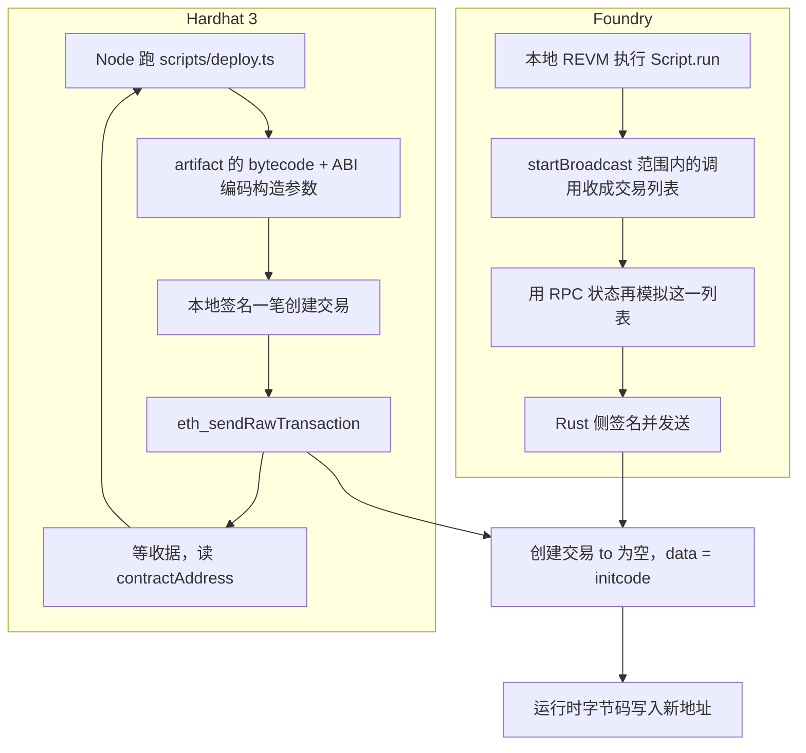

# Hardhat 3 与 Foundry：同一笔创建交易的两条组装路径

链上不认识 Hardhat，也不认识 Foundry。节点只执行一笔**合约创建交易**：`to` 为空，`data` 是 initcode。执行成功后，运行时字节码写进状态树，地址由发送者地址和 nonce 决定。

Hardhat 3 的 TypeScript 脚本和 Foundry 的 Solidity 脚本，做的是同一件链下工作：把编译产物装进这笔交易，签上名，用 `eth_sendRawTransaction` 送出去。差别在**编排进程**：

- Hardhat 3 的脚本是一个 Node 进程。每调用一次 `deployContract`，就当场组交易、签名、发送、等收据，下一行再看链上结果。
- Foundry 的脚本是一份 Solidity 合约。`forge script` 先在本地 EVM 里跑完 `run()`，把 `vm.startBroadcast()` 范围内的调用收成交易列表，再单独模拟，最后才签名发送。脚本合约本身不会部署到目标链。

官方参考：[Hardhat 3：用脚本部署](https://hardhat.org/docs/guides/deployment/using-scripts.md)、[Hardhat 3 Network Manager](https://hardhat.org/docs/reference/network-manager.md)、[viem `deployContract`](https://github.com/wevm/viem/blob/main/src/actions/wallet/deployContract.ts)、[Foundry：How scripting works](https://www.getfoundry.sh/forge/scripting-internals)、[Foundry `startBroadcast`](https://getfoundry.sh/reference/cheatcodes/start-broadcast/)。创建交易的地址公式见 [CREATE / CREATE2 / CREATE3](./create-create2-create3.md)，手续费字段见 [EIP-1559](./eip-1559.md)。

---

## 节点收到的是什么

一笔普通部署是 EIP-1559（类型 `0x02`）创建交易。签名覆盖的载荷是：

```text
0x02 || rlp([
  chainId,
  nonce,
  maxPriorityFeePerGas,
  maxFeePerGas,
  gasLimit,
  to,          // 创建交易：空字节串
  value,
  data,        // initcode
  accessList
])
```

`to` 的 RLP 是空串 `0x80`。`data` 里没有函数选择器。Solidity 构造函数的参数 ABI 编码后直接接在创建字节码后面，整段一起当 initcode：

```text
initcode = creation bytecode || abi.encode(constructorArgs)
```

`creation bytecode` 里包含构造函数逻辑，以及准备返回的运行时字节码。构造函数从**代码末尾**把参数切出来（`codesize` 含这段尾巴），参数不走 calldata。构造函数里的 `SSTORE` 发生在 initcode 执行期间，成功后保留。`immutable` 在 `RETURN` 之前被写进即将部署的运行时字节码。

节点处理这笔交易的顺序：

1. 从签名恢复发送者。`chainId` 进了被签名的载荷，同一条原始交易不能拿到另一条链上重放。
2. 交易里的 `nonce` 必须等于该账户当前 nonce。通过后账户 nonce + 1。
3. 预扣 gas 和 `value`。
4. 计算地址。用的是递增**之前**的 nonce，也就是这笔交易自己的 nonce：

```text
address = keccak256(RLP([sender, nonce]))[12:]
```

5. 该地址上不能已有代码或 nonce（碰撞则失败）。
6. 把 `value` 转到新账户，执行 initcode。执行环境里 `msg.sender` 是这笔交易的 `from`，`address(this)` 是刚算出的地址。
7. initcode 用 `RETURN` 交出运行时字节码。按字节收代码存款 gas（每字节 200）。字节码不能以 `0xEF` 开头（EIP-3541），部署后长度不能超过 24576（EIP-170）。initcode 本身还有上限 49152（EIP-3860），构造参数算在里面。
8. 代码写入状态。收据的 `contractAddress` 就是这个地址。

构造函数 revert 时：交易已经上链，发送者 nonce 已经加一，代码不会留下，状态修改回滚。下一笔部署用的是新 nonce，地址也变了。交易在进块之前就被节点拒绝（nonce 偏小、余额不足）时，nonce 不动。

两条工具链成功时，链上留下的就是上面这个结果。



---

## Hardhat 3：TypeScript 脚本当场发送

`hardhat run scripts/deploy.ts` 启动的是 Node。脚本不在 EVM 里执行。当前写法是先拿一条网络连接，再按合约名部署（`network.connect()` 已废弃）：

```ts
import { network } from "hardhat";

const { viem } = await network.create();
const counter = await viem.deployContract("Counter", [0n]);
console.log(counter.address);
```

`network.create()` 每次建一条独立的 `NetworkConnection`。连接有两种，脚本侧 API 相同：

| 连接 | 配置类型 | 交易送到哪 |
| --- | --- | --- |
| 本地模拟链 | `edr-simulated`（`default` 网络的默认值） | 进程内的 EDR。EDR 是 Hardhat 3 的本地区块链，对外仍是 JSON-RPC |
| 远程节点 | HTTP 网络，例如 `sepolia` | 配置里的 RPC。`eth_sendRawTransaction` 进对方 mempool |

不传参时用配置里的 `default` 网络，因此裸跑 `hardhat run` 部署的是一条新的本地链，进程退出就没了。上测试网要显式选网络，并用 `production` 构建配置，避免部署和测试用了两套优化器字节码：

```bash
hardhat run scripts/deploy.ts --network sepolia --build-profile production
```

`viem.deployContract("Counter", [0n])` 在进程里做这些事：

1. **取编译产物。** Hardhat 按合约名从 artifact 读出 `abi` 和 `bytecode`。有外部库时，先把字节码里的链接占位符替换成库地址。这一步只改本地字节串。
2. **拼 initcode。** hardhat-viem 把 abi、bytecode、构造参数交给 viem 的 `deployContract`。viem 用 `encodeDeployData` 把参数 ABI 编码后接到 bytecode 末尾。
3. **组交易请求。** wallet client 的 `sendTransaction` 不带 `to`（带 EIP-7702 `authorizationList` 时才会把 `to` 写成 `null`）。普通部署因此是创建交易，`data` 就是 initcode。
4. **补齐未签名字段。** 同一条连接上会查 `eth_getTransactionCount`（pending nonce）、`eth_estimateGas`，并用费用接口填 `maxFeePerGas` / `maxPriorityFeePerGas`。网络配置里的 `gas`、`gasMultiplier`、`gasPrice` 只影响 Hardhat 创建的 Provider、Client、Signer 发出的交易，不改你直接打到节点上的 `eth_estimateGas`。
5. **本地签名。** 账户来自 Hardhat keystore 或配置里的私钥。secp256k1 签名发生在本机，私钥不进 `data`。
6. **发送并等待。** `eth_sendRawTransaction` 之后，`deployContract` 默认等 1 个确认，再从收据的 `contractAddress` 得到地址，返回带类型的合约实例。

`sendDeploymentTransaction` 只送到拿到 hash 就返回，地址要等收据才有。`ethers.deployContract("Counter")` 走 ethers 的 `ContractFactory`：同样是 bytecode 接上 ABI 编码的构造参数，再由 signer 发一笔没有 `to` 的交易。换库不换链上格式。

脚本是活的。`await viem.deployContract(...)` 返回时，这笔交易已经进块。下一行可以 `eth_call` 刚部署的合约，再按返回值决定下一笔交易的 calldata。每一笔的 nonce、gas、费用都按当时的节点状态重算。

脚本没有内建的断点续传。进程在第二笔交易处退出，再跑一遍会把第一笔再部署一次。Hardhat Ignition 是另一套声明式部署，会把进度记在 `ignition/deployments/`，那不是 `hardhat run` 这条路径。

---

## Foundry：先在本地把 Solidity 跑成交易列表

本仓库的入口是 `script/Counter.s.sol`：

```solidity
function run() public {
    vm.startBroadcast();
    counter = new Counter(0);
    vm.stopBroadcast();
}
```

`vm` 是地址 `0x7109709ECfa91a80626fF3989D68f67F5b1DD12D` 上的接口（`lib/forge-std/src/Base.sol`）。这是 Foundry EVM 的作弊码入口。发往该地址的调用由本地执行器截获，不会变成链上交易。

`forge script` 把一次部署拆成五段。前两段总会发生；后面三段取决于有没有 RPC、有没有 `--broadcast`。

| 阶段 | 跑什么 | 留下什么 |
| --- | --- | --- |
| 编译、链接 | solc 编译脚本合约和它引用的合约 | 脚本字节码、artifact、库地址 |
| 执行脚本 | 本地 EVM 部署脚本合约，调 `setUp()`，再调 `run()`（或 `--sig` 指定的函数） | 从 broadcast 调用里收集的交易，加上必须先部署的库 |
| 模拟交易 | 把收集到的交易放到一份独立的、由目标 RPC 支撑的本地状态上重放 | gas、追踪、部署元数据 |
| 广播 | `--broadcast` 时签名并 `eth_sendRawTransaction` | 交易哈希和收据 |
| 验证 | 需要时提交到区块浏览器 | 验证结果 |

没有 RPC 时只能做本地执行，不能做 RPC 模拟，也不能发送。有 RPC 但不加 `--broadcast` 时，执行加模拟，不发送。`--skip-simulation` 跳过的是第三段，收集交易的那段本地执行仍然会跑。

脚本合约只存在于这次本地执行。目标链上的创建者是交易的 `from`，公式里的 sender 是那个 EOA（或你指定的发送账户），不是脚本合约地址。

### 三个地址是分开的

| 角色 | 是谁 | 决定什么 |
| --- | --- | --- |
| 脚本调用者 | Forge 用来调用 `setUp()` / `run()` 的地址 | 脚本函数帧里的 `msg.sender` |
| 交易发送者 | 收进交易列表的 `from` | 链上 `msg.sender`、CREATE 地址里的 sender、nonce 序列 |
| 签名者 | 掌握这个 `from` 对应私钥的钱包 | 广播时能不能签出这笔交易 |

默认脚本调用者是 `0x1804c8AB1F12E6bbf3894d4083f33e07309d1f38`。命令行只给了一把私钥时，Forge 会用这把钥匙推出调用者。`--sender` 可以单独指定。

`vm.startBroadcast()` 的三个重载只决定**交易发送者**，不改已经在跑的 `run()` 那一帧的 `msg.sender`：

| 写法 | 交易 `from` | 签名材料 |
| --- | --- | --- |
| `startBroadcast(address)` | 传入的地址 | 广播时另外要有这把钥匙，或 `--unlocked` 交给节点签 |
| `startBroadcast(uint256)` | `vm.addr(privateKey)` | 这把私钥登记进本次脚本的钱包 |
| `startBroadcast()` | `--sender`，否则唯一可用的签名者，否则当前交易调用者 | 广播时必须拿得到 |

`broadcast` 只记录下一次调用；`startBroadcast` 记录到 `stopBroadcast`。范围是**打开广播的那一层调用深度**。作弊码调用排除在外。新合约内部再发生的调用，留在那一笔交易里面，不会再拆成新的顶层交易。

因此脚本帧里的 `msg.sender` 和部署出来的合约里的 `msg.sender` 可以不是同一个。默认 `script_execution_protection = true` 时，如果二者不同，Forge 会拒绝在广播帧里读取 `msg.sender`。这个检查不追溯广播开始前已经抄进变量的值。本仓库 `script/BaseScript.s.sol` 的 `broadcaster` 就是在 `startBroadcast()` **之前**把 `msg.sender` 存进 `deployer`。无参 `startBroadcast()` 且脚本调用者就是那把唯一私钥时，两者一致。改成 `startBroadcast(privateKey)` 时要用 `broadcasterWith`，那里的 `deployer` 取的是 `vm.addr(privateKey)`。

`--sender` 够用来模拟。真正广播还要有对应钱包（`--account`、`--private-key`，或硬件钱包）。`--unlocked` 时由 RPC 节点代发。交易发送者如果还是 Foundry 默认地址，普通广播会被拒绝。

### `new Counter(0)` 被收成什么样的交易

广播深度上直接写 `new Counter(0)`，收集到的是一笔创建交易：`from` 是广播发送者，`data` 是 Counter 的 initcode（含构造参数 `0`）。本地执行时这笔 CREATE 真的在本地 EVM 里跑过，所以 `new` 的返回值立刻是地址，后面的 Solidity 可以拿它继续编码下一笔交易的参数。这个地址只在「广播时 nonce 仍是模拟时的 nonce」的前提下和链上一致。

同一深度上的 `new Contract{salt: salt}(...)` 不会让 EOA 去执行 CREATE2。EOA 的创建交易只有 CREATE。Forge 把它改写成一笔发往 CREATE2 部署器的普通调用，默认部署器是 `0x4e59b44847b379578588920ca78fbf26c0b4956c`。calldata 是 `salt` 接上 initcode，部署器内部再做 CREATE2。三件事随之改变：

- 构造函数的 `msg.sender` 是部署器，外层交易的 `from` 仍是钱包。
- 地址取决于部署器、salt、完整 initcode。构造参数和链接进去的库地址都算 initcode。
- 外层交易照样消耗钱包 nonce，但这个 nonce 不进 CREATE2 公式。

Forge 会检查目标链上这段部署器字节码。地址上没代码，或代码对不上，这次路由就不成立。本地无 RPC 演练时，Forge 可以在本地状态里装上默认部署器；那不会把它装到目标链上。要换别的工厂，就按那个工厂的 ABI 显式调用。工厂合约内部自己做的 CREATE2，走的是那份合约的执行环境，不会被这段脚本级改写碰到。

### 第二轮模拟不重跑 `run()`

第一轮执行脚本逻辑：读环境变量、算参数、写文件、打日志，以及广播范围之外的调用。这些可以影响**收集到的 calldata**，但它们自己不是交易。`vm.readFile`、`console.log`、`vm.writeFile` 都停在本地。

第二轮从一份新的 RPC 状态开始，只重放收集好的交易。它不重新调用 `run()`，也不会把脚本合约自己的存储带过去。本地 `vm.store` 能让第一轮成功，第二轮仍会失败，只要那些交易依赖的状态在目标链上不存在。

模拟之后 Forge 乘上 `gas_estimate_multiplier`（`foundry.toml`，默认 130）得到 gas limit。费用在广播前再填。`--slow` 会在交易之间等待收据，并在模拟时把区块号往前推。多笔交易不是一次原子执行：前面的可以已经上链，后面的再失败。

有 RPC 时，起始 nonce 来自分叉状态；没有 RPC 时从 1 起算。`--sender-nonce` 只影响计划，不改链上账户。每个发送者各自一条 nonce 序列。外部库若要先用 CREATE 部署，会占掉这段序列开头的 nonce，后面合约的 CREATE 地址跟着变。CREATE2 链接的库如果目标地址上已经有代码，就跳过部署。

广播时 Forge 把节点上的 nonce 和计划里的 nonce 比较：节点落后就重试，节点已经超前就报错。这个检查不锁 nonce。模拟之后、进块之前，别的进程用掉了这个 nonce，计划就作废。

### 产物与 `--resume`

交易序列和收据写在 `broadcast/<脚本>/<chainId>/`。演练（不加 `--broadcast`）写在其中的 `dry-run/`。Foundry 1.8.4 起，续传的权威状态是 `cache` 目录里的 `.recovery.json`；`broadcast/` 下的文件是对外导出。两边都要留到部署结束。

`--resume` 读取已保存的序列，跳过已经成功的交易，继续发送剩下的。它跳过第三段模拟，也**不会**因为你改了脚本就重算 calldata。要一份新计划，就去掉 `--resume` 重新跑。

本仓库的 `BaseScript` 在 `stopBroadcast()` 之后才写 `deployments/`。收据摘要里的 Contract Address，对「顶层就是 CREATE」的交易是对的；对「顶层是 CALL、合约在内部 CREATE」的交易，那个字段不是内部新合约的地址。`saveContract` 存的是脚本里 `new` 或工厂调用返回的地址。没加 `--broadcast` / `--resume` 时它不覆盖已有部署文件。

---

## 同一句部署，两边各做了哪一步

部署 `Counter`，构造参数 `0`。

| | Hardhat 3 `viem.deployContract("Counter", [0n])` | Foundry `new Counter(0)`，包在 `startBroadcast` 里 |
| --- | --- | --- |
| 谁在执行「脚本」 | Node 进程 | 本地 REVM 里的脚本合约 |
| initcode 从哪来 | artifact 的 bytecode，进程里再接上 ABI 编码的 `0` | solc 编进 `new` 的创建代码；本地 CREATE 执行时被记录下来 |
| 什么时候发给节点 | 这一行里就发，并默认等 1 个确认 | `run()` 全部收集完，再模拟，`--broadcast` 时才发 |
| 地址从哪来 | 收据的 `contractAddress` | 本地 CREATE 的返回值；广播时 nonce 一致才会和收据相同 |
| 下一行能否看见新合约 | 能。`await` 返回时已经进块 | 收集阶段能看见本地执行结果。链上结果要等广播阶段 |
| 脚本中途 revert 之后再跑 | 已上链的部署还在，脚本会再部署一份 | `--resume` 接着发剩余交易；去掉该标志则按当前 nonce 重新计划 |
| 私钥在哪 | keystore 或配置，wallet client 本地签名 | CLI / keystore / `startBroadcast(uint256)` 登记的钱包，Rust 侧签名 |

两边发出去的成功交易，字段结构相同：`to` 为空，`data` 为 Counter 的 initcode，`from` 为部署账户。`Counter` 构造函数里的 `msg.sender` 是这个账户。

---

## 同样一句话，链上效果会分叉的地方

**按链上状态分支。** Hardhat 脚本在每笔收据之后继续跑，下一笔的 calldata 可以取决于刚读到的存储。Foundry 的分支发生在第一轮本地执行；第二轮和广播都不再改 calldata。模拟和下一块之间被别人插进一笔交易时，Foundry 仍会发送当初收集的那份数据。

**CREATE2。** Hardhat 的 `deployContract` 始终是 EOA 的 CREATE。要 CREATE2，就自己调用工厂。Foundry 在脚本顶层写 `new Contract{salt: ...}` 时，会改写成对默认 CREATE2 部署器的调用。构造函数看到的 `msg.sender` 因此是部署器。细节和地址公式在 [CREATE / CREATE2 / CREATE3](./create-create2-create3.md)。

**外部库。** 两边都要在部署前把库地址写进字节码。Foundry 还会把尚未部署的库排进同一条交易序列的前面，占用 nonce，从而改变后面 CREATE 的地址。只被脚本使用、没有进最终合约的库，Forge 可能留在本地，不广播。换一个库地址就会改变引用方的字节码，CREATE2 地址和浏览器验证的输入一起变。

**Nonce。** Hardhat 每次发送前向节点要 pending nonce。Foundry 在收集时从分叉状态分配 nonce，广播时发现节点超前就停止。两个进程同时用一个部署账户，都会踩到对方。

**失败的位置。** Hardhat 在 `eth_estimateGas` 或收据状态里看到 revert。Foundry 多一次机会：第二轮模拟失败时，默认不会把这批交易发出去。模拟通过、进块时状态已经变了，链上仍可能 revert，而且前面的交易不会回滚。

---

## 本仓库怎么部署

部署脚本在 foundry 仓库，后端仓库不跑 Hardhat。`Counter` 的广播命令：

```bash
cd bootcamp_2026_s3_vibe_coding_foundry
source .env
forge script script/Counter.s.sol:CounterScript \
  --rpc-url "$SEPOLIA_RPC_URL" \
  --broadcast \
  --private-key "$SEPOLIA_PRIVATE_KEY"
```

不加 `--broadcast` 时只做本地执行和 RPC 模拟，交易留在 `broadcast/.../dry-run/`。继承 `BaseScript` 并调用 `saveContract` 的脚本，在广播结束后把地址写到 `deployments/<name>/<name>_<chainId>.json` 和 `deployments/LATEST.txt`。

下一笔 CREATE 的地址可以用后端的预测脚本，对着部署账户的当前 nonce 算：

```bash
cd bootcamp_2026_s3_vibe_coding_backend
npm run predictCreate -- 0xYourDeployerAddress
```
