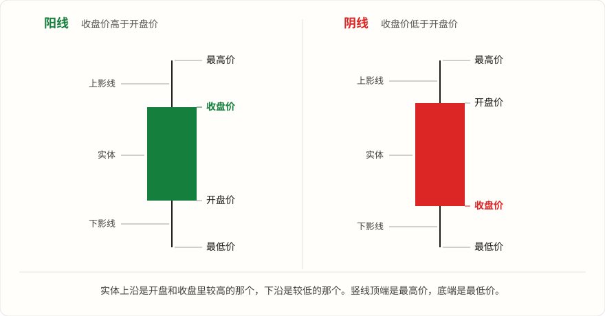
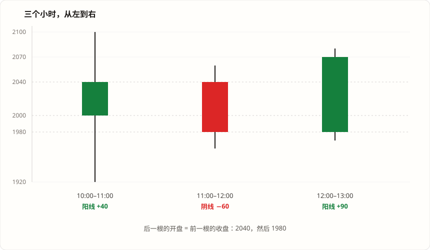
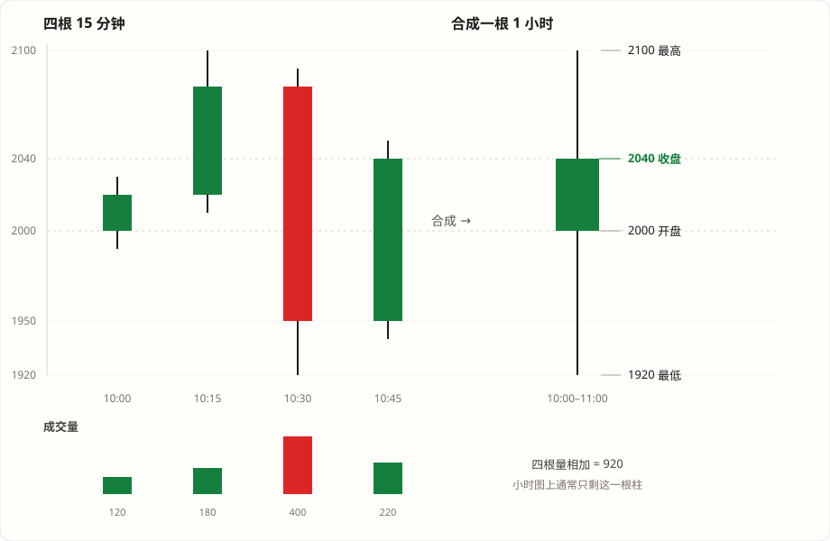
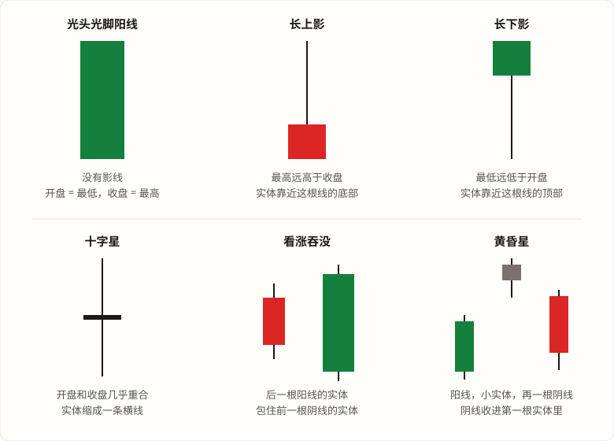

# K 线怎么看

行情软件里一根红的或绿的柱子，就是一根 K 线。它代表一段时间，比如 15 分钟、1 小时、1 天。

一根线只记四个价格：

- **开盘价**：这段时间开始时的价格
- **收盘价**：这段时间结束时的价格
- **最高价**：这段时间里到过的最高价格
- **最低价**：这段时间里到过的最低价格

先记住画法：

1. 中间的方块，两端是开盘价和收盘价。收盘更高，这根是涨的，叫**阳线**。收盘更低，这根是跌的，叫**阴线**。
2. 方块上方的细线接到最高价，叫**上影线**。下方的细线接到最低价，叫**下影线**。
3. 细线的意思是：价格曾经到过那里，收盘没有停在那里。

英文名叫 candlestick 美/ˈkændlstɪk/ 蜡烛台，因为画出来像一根蜡烛。方块叫实体。方块上下两根细线合在一起叫影线，也就是上影线和下影线。其中特别长的那根，口语里叫插针。上面长、下面长，或者两根都很长，都可以叫插针。

下面的图在 Markdown 预览里看。编辑器里如果只看见图片链接，打开预览。



左边那根是涨的：收盘画在方块顶上，开盘画在方块底下。右边那根是跌的：两个价格换了位置，开盘在顶上，收盘在底下。两根的细线都一样，顶端是最高价，底端是最低价。

本文的图按币圈习惯上色：涨是绿色，跌是红色。Binance、TradingView 和多数 DEX 行情站也是这套。

股票软件常用另一套：涨是红色，跌是绿色。同花顺、东方财富这类 A 股软件就是这样，港股行情里也很常见。同一根阳线，在币圈图上是绿的，在这些股票软件里是红的。

---

## 颜色先看图例

看一张新图时，先找图例，确认它用的是上面哪一套。也可以不看颜色，直接比这一根的收盘价和开盘价。收盘更高就是涨，收盘更低就是跌。

有的软件把涨的方块画成空心。空心仍然是涨，不是没有成交。图表类型选普通 K 线就好。

---

## 用一个小时把四个价格算出来

下面的价格是编的，用来算给自己看，不是某天的真实行情。假设看的是 ETH 的美元价格。先把 10:00 到 11:00 这一个小时算完，再接上后面两个小时。

10:00 的价格是 2000。这是这一小时的开盘价。

11:00 的价格是 2040。这是收盘价。

这一小时里面，价格最高到过 2100，最低到过 1920。

收盘 2040 高于开盘 2000，所以这是一根阳线，绿色方块。

| 你在图上看到的 | 怎么得到 | 这根线 |
| --- | --- | --- |
| 开盘价 | 10:00 的价格 | 2000 |
| 收盘价 | 11:00 的价格 | 2040 |
| 最高价 | 这一小时里的最高 | 2100 |
| 最低价 | 这一小时里的最低 | 1920 |
| 方块（实体） | 收盘 − 开盘 | 40 |
| 上影线 | 最高 − 收盘 | 60 |
| 下影线 | 开盘 − 最低 | 80 |

上影线用「最高 − 收盘」，是因为这根是阳线，收盘比开盘高，方块顶就是收盘。如果是阴线，方块顶是开盘，上影线就是「最高 − 开盘」。记法可以合成一句：上影线从方块顶接到最高价，下影线从方块底接到最低价。

这根线涨了 40。2000 的 2% 是 40，所以涨幅是 2%。

最高和最低相差 180。180 / 2000 = 9%。涨幅 2%，这段时间里的上下波动是 9%。「这根在涨」和「中间晃得很厉害」要分开看。

收盘 2040 离最高还差 60，离最低有 120。它停在偏上的位置，上面仍留着一段上影线。

---

## 连着看三个小时

第一个小时收在 2040。后面两个小时接着算，每根仍是一个小时。这个例子里交易没有断开，所以上一根的收盘就是下一根的开盘。

| 时间 | 开盘 | 最高 | 最低 | 收盘 | 涨跌 | 方块 | 上影线 | 下影线 |
| --- | --- | --- | --- | --- | --- | --- | --- | --- |
| 10:00–11:00 | 2000 | 2100 | 1920 | 2040 | +40 | 40 | 60 | 80 |
| 11:00–12:00 | 2040 | 2060 | 1960 | 1980 | −60 | 60 | 20 | 20 |
| 12:00–13:00 | 1980 | 2080 | 1970 | 2070 | +90 | 90 | 10 | 10 |



三根从左到右读：

**10:00–11:00，阳线。** 方块从 2000 画到 2040，高度 40。上影线 60，下影线 80。这一小时结束时涨了 40，中间却到过 2100 和 1920。细线比方块长，大部分波动发生在方块外面。

**11:00–12:00，阴线。** 开盘 2040 在方块顶上，收盘 1980 在方块底下，方块高 60。最高只到 2060，最低只到 1960，上下影线各 20。这根和第一根相反：方块比影线长。这一小时主要在跌，收盘停在偏低的位置。上影线要改用「最高 − 开盘」，因为阴线的方块顶是开盘，不是收盘。

**12:00–13:00，阳线。** 开盘 1980 在方块底下，收盘 2070 在方块顶上，方块高 90。最高 2080 只比收盘高 10，最低 1970 只比开盘低 10。影线很短，这一小时的价格基本顺着涨的方向走。

三根放在一起，方块方向是涨、跌、再涨。13:00 的价格是 2070，比 10:00 的 2000 高。只看最后这个 2070，看不到第二根曾经收到 1980，也看不到第一根曾经跌到 1920。所以要一根一根看方块和影线，不能只看最右边的收盘价。

这三根都是小时线。第一根里面先涨还是先跌，要换成 15 分钟才看得清。下面就拆第一根。

---

## 这一小时里到底先发生了什么

上面那根小时线，把 60 分钟收成了四个数。先后顺序不在这四个数里面。把周期换成 15 分钟，同一小时变成四根线：

| 时间 | 开盘 | 最高 | 最低 | 收盘 | 这 15 分钟涨跌 | 成交量 |
| --- | --- | --- | --- | --- | --- | --- |
| 10:00–10:15 | 2000 | 2030 | 1990 | 2020 | +20 | 120 |
| 10:15–10:30 | 2020 | 2100 | 2010 | 2080 | +60 | 180 |
| 10:30–10:45 | 2080 | 2090 | 1920 | 1950 | −130 | 400 |
| 10:45–11:00 | 1950 | 2050 | 1940 | 2040 | +90 | 220 |
| 整小时 | 2000 | 2100 | 1920 | 2040 | +40 | 920 |

按时间读：

1. 前 15 分钟从 2000 收到 2020，小涨。
2. 接下来 15 分钟继续涨，最高摸到 2100，收在 2080。这一小时的最高价出现在这里。
3. 10:30 这根从 2080 砸到收盘 1950，最低 1920。这是一根很长的阴线，成交量也最大。这一小时的最低价出现在这里。
4. 最后 15 分钟从 1950 拉回 2040。因为拉回了，整小时的收盘仍高于开盘，小时线才是阳线。



对着图看右边那根小时线：方块只有 2000 到 2040 那么短，细线却从 1920 拉到 2100。左边才能看见，下影线是 10:45 那根把价格拉回去的，不是价格在 1920 上碰了一下立刻弹回。

四段的涨跌加起来是 20 + 60 − 130 + 90 = 40，等于这一小时的涨跌。最高价要在四段里挑最大的一个，2100，不能把四个最高价加在一起。成交量可以相加，120 + 180 + 400 + 220 = 920。

10:30 那根的成交量是 400，接近这一小时 920 的一半。合成小时线以后，下面通常只剩一根高度为 920 的柱子，看不出量主要打在下跌的那 15 分钟。

周期按钮（1 分钟、15 分钟、1 小时、1 天）换的是一根线代表多久。周期越长，一根线盖住的细节越多。一根影线看不懂，就把周期调小一档。

图最右边那根，如果它的时间还没走完，收盘价就是现在的最新价，最高价和最低价还会变。左边已经走完的线，四个价格就固定了。

在这个例子里，上一根的收盘正好等于下一根的开盘。股票晚上停盘，第二天的第一笔可能和昨天的收盘差一截，两根 K 线之间会空开。币全天都有成交，这种空档少一些。

日线从哪个钟点切开，看行情网站。Binance 的日线从 UTC 0 点开始。A 股的一根日线覆盖一个交易日，上午和下午画在同一根里。

---

## 影线长，只说明价格到过那里

用上面那根小时线：

- 上影线 60：价格到过 2100，收盘停在 2040，比最高低。
- 下影线 80：价格到过 1920，收盘停在 2040，比最低高。

影线不写是谁在买卖，也不写下一根会涨还是会跌。成交很少的市场里，一笔单就可以把价格打到很高或很低再打回来，影线会特别长，方块可以很短。

常见外形有名字。名字只是外形的称呼。下图里的六种，对照着认就够了。



- **光头光脚阳线**：没有细线。开盘就是最低，收盘就是最高，这段时间一路在涨。阴线则反过来，开盘是最高，收盘是最低。
- **长上影**：细线往上伸得很长。价格冲高过，收盘离那个高点很远。
- **长下影**：细线往下伸得很长。价格砸低过，收盘离那个低点很远。
- **十字星**：开盘和收盘几乎是同一个价，方块缩成一条横线。这段时间结束时，价格回到了开始附近。
- **看涨吞没**：前一根是跌的，后一根是涨的，而且后一根的方块把前一根的方块整个包住。看跌吞没把颜色对调。
- **黄昏星**：涨了一段之后，先一根阳线，再一根方块很小的线，然后一根阴线跌回第一根方块的内部。出现在下跌之后、方向相反的叫早晨星。

长下影出现在一段下跌之后，书上常叫锤子线；同样的外形出现在一段上涨之后，常叫上吊线。长上影也有两套名字。外形一样，差别只在它前面几根是在涨还是在跌。这些名字不负责预测下一根。

---

## 下面的柱子是成交量

K 线下面那一排柱子，和上面的线共用时间。柱子越高，这段成交越多。颜色一般跟着上面那根：涨的线，柱子也用涨的颜色。

在 15 分钟的例子里，柱子是 120、180、400、220。砸下去的那根最高。柱子高只说明这一段成交多。

柱子的单位看坐标旁边的字。有的按币的个数算，有的按成交金额算。

---

## 三种看起来像、其实不是同一张图

**分时图**把最新价一个点一个点连成线，不分成一根根 K 线，也没有开盘、最高、最低、收盘四个价。股票软件里，分时和 K 线通常是两个页面。

**美国线**没有方块。一根竖线从最低画到最高，左边短横是开盘，右边短横是收盘。表达的四个价格和 K 线相同。

**平均 K 线**（软件里常标成 Heikin Ashi）把前后几根掺在一起再画。图上的开盘、收盘不是真实成交价，趋势看起来更顺。要看真实价格，图表类型选普通 K 线。

穿过蜡烛的平滑曲线，一般是用收盘价另外算的均线。可以先关掉，只留 K 线和成交量。

---

## 看一张图的五步

1. 看坐标。纵轴是什么价格，比如「1 ETH 等于多少 USDC」。横轴上一根代表 1 分钟、15 分钟，还是 1 天。最右边那根如果时间还没结束，收盘就是现在的价格，还会变。纵轴如果标着 log，同样的像素在高价区代表更大的价差，比长短时去读价格数字。
2. 看图例里涨是绿色还是红色。拿不准就比收盘和开盘。
3. 看最近几根已经走完的方块，大体是在往上排，还是往下排。
4. 看最后一根走完的线：收盘比开盘高多少，上影线和下影线长不长。
5. 某根影线看不懂，把周期调小一档。看它是在一个小段里走完的，还是后面几个小段补上的。再看哪几根下面的成交量柱子特别高。

---

## 池子里的价格（可以后看）

DexScreener、TradingView 上的 K 线，是网站把一段时间里的价格统计出来的。Uniswap V3 的池子合约里没有开盘、最高、最低、收盘这四个数。

合约里有当前价格，存在 `slot0.sqrtPriceX96`。另外有一串按时间累计的数，用来算这段时间的平均价，叫 TWAP。

两件事不一样。K 线的最低价只要出现过就会记下，哪怕只存在一个区块。平均价看价格在每个位置停留了多久，停留得久，平均数就靠近那里。所以平均价可以停在高位，K 线仍然拖着一根长长的下影线。

网站上写着 ETH/USDC 的图，纵轴一般是「1 ETH 多少 USDC」，按纵轴的文字读就行。

池子内部记的价格是另一种方向：token1 / token0，也就是 1 个 token0 值多少 token1。token0 是两个代币里地址比较小的那个。主网 USDC 的地址是 `0xA0b86991c6218b36c1d19D4a2e9Eb0cE3606eB48`，WETH 是 `0xC02aaA39b223FE8D0A0e5C4F27eAD9083C756Cc2`。USDC 的地址更小，所以它是 token0。这个内部价格变大，表示 1 USDC 能换到更多 WETH，也就是用美元看 ETH 变便宜了。网站若已经标成 ETH/USDC，通常已经换成「1 ETH 多少美元」的方向。

交易所的 K 线来自一笔一笔成交。池子的行情图通常取每一次兑换之后的价格。一笔很大的兑换可以自己把价格打得很远，后面的兑换再把它打回来。图上就是一根长针，针尖是池子真实到过的价格。

不同网站取价的方式还可能差一个区块内部的细节。看图时先确认它画的是哪个池子，或者哪家交易所。同一个 ETH，交易所上的影线和一个很薄的池子上的影线，不会一样。

---

## 用代码算一根（可以后看）

一段里的价格按时间排好，第一个是开盘，最后一个是收盘，最大的是最高，最小的是最低。

```text
open  = price[0]
close = price[n-1]
high  = max(price)
low   = min(price)

上影线 = high - max(open, close)
下影线 = min(open, close) - low
```

`max(open, close)` 就是方块顶上的那个价格，`min(open, close)` 就是方块底下的那个价格。阳线、阴线都用这两行，不用先判断谁高。

这一段里一笔价格都没有，就没有这根线。不要用 0 去填。

时间还没结束时，收盘、最高、最低只用已经出现的价格，后面的新成交会改它们。

几根小周期合成一根大周期：开盘用第一根的开盘，收盘用最后一根的收盘，最高用所有最高里最大的那个，最低用所有最低里最小的那个，成交量相加。涨跌可以相加。最高价、最低价和影线不能把小周期的结果直接加起来。
