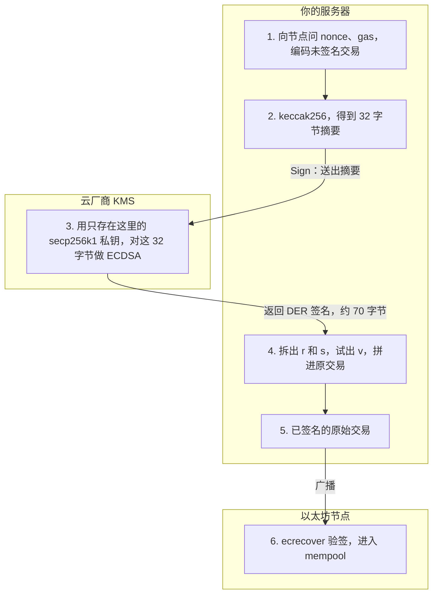

# KMS：用云上的钥匙签以太坊交易

这段资料写的是一个 `KMSSigner`。它继承 ethers 的 `Signer`，用来替换平时的 `new ethers.Wallet(私钥, provider)`。私钥在 AWS KMS 里生成，签名时私钥不出 KMS。服务器先在本地把交易收成 32 字节的 keccak 摘要，只把这段摘要送出去；KMS 对它做 ECDSA，返回的是签名（DER 编码的 `r` 和 `s`，大约 70 字节）。那 32 字节是送去签的摘要，不是签名本身。

Google Cloud KMS、Azure Key Vault 换的是「把摘要送去签名」那一次 API。地址算法、收 `s`、试出 recovery id，三家一样。

官方参考：[AWS KMS Sign](https://docs.aws.amazon.com/kms/latest/APIReference/API_Sign.html)、[AWS：用 KMS 管以太坊账户（Part 2）](https://aws.amazon.com/blogs/database/part2-use-aws-kms-to-securely-manage-ethereum-accounts/)、[Azure Key Vault 密钥类型](https://learn.microsoft.com/en-us/azure/key-vault/keys/about-keys-details)。

---

## 你的服务器和云厂商各管一段

发一笔交易要经过三处。私钥只在云厂商的 KMS 里。你的服务器负责把交易变成摘要、把签名拼回去、再广播。以太坊节点只收已经签好的交易，它和 KMS 不是同一家。



跨过你和云厂商之间的只有两次调用：

| 方向 | 内容 | 字节 |
| --- | --- | --- |
| 服务器 → KMS | keccak 摘要。交易里的 `to`、`value`、nonce 留在服务器 | 32 |
| KMS → 服务器 | 签名，DER 编码的 `r` 和 `s` | 大约 70 |

KMS 拿到摘要就签名，不组装交易，也不把交易发上链。第 6 步是你的服务器拿着拼好的原始交易，通过 `provider` 发给节点。这个节点可以是你自己的，也可以是 Alchemy 这类 RPC，它看不到 KMS 里的私钥。

各处留下的东西：

| | 你的服务器 | 云厂商 KMS | 以太坊节点 |
| --- | --- | --- | --- |
| 拿在手里 | 交易字段、32 字节摘要、拼好的原始交易、调用 KMS 的云账号凭证 | secp256k1 私钥 | 已签名交易和链上状态 |
| 算出来给别人 | 摘要、最终的原始交易 | DER 签名；另外可导出公钥 | 打包结果 |
| 问地址时 | 用公钥自己算 `keccak256(x‖y)` 的后 20 字节 | `GetPublicKey` 只给出公钥 | 按这个地址收交易 |

云账号凭证（AWS 的 access key，或挂在这台机器上的 IAM 角色）在你的服务器上。它用来向厂商证明「可以让这把钥匙签一下」，本身不是以太坊私钥。磁盘被拷走时，拷走的是这套凭证和业务代码，拷不走私钥。对方要能接着签，还得拿这套凭证通过厂商的鉴权。

---

## 它换掉的是 Wallet，不是合约

链上只认地址和签名。谁拿着私钥，是链下的事。

```text
应用代码
  signer.sendTransaction({ to, value })     ← Signer 基类，资料没重写
      1. 用 provider 补 nonce、gas、chainId
      2. signTransaction(tx)                 ← 这个类要自己写
      3. provider.broadcastTransaction(raw)
```

普通 `Wallet` 在 `signTransaction` 里用本进程内存里的私钥做 ECDSA，私钥就在你的服务器上。`KMSSigner` 把这一步换成图里的第 3 步：摘要交给云厂商。问 nonce 和广播仍在基类里，发生在你的服务器和以太坊节点之间。

这和社交恢复钱包是两件事。社交恢复管的是链上「这把钥匙丢了，守护者怎么换主人」。KMS 管的是服务器发交易时，私钥不要落在磁盘或环境变量里。

---

## 一笔交易实际签的是什么

以太坊签的不是交易原文，是未签名交易编码后的 keccak256，固定 32 字节。

```text
resolveProperties(tx)          把 nonce、gas 这些还没落地的字段摊平
serializeTransaction(tx)       按交易类型做 RLP / typed-tx 编码（不含签名）
digest = keccak256(上面的编码)
ECDSA_sign(私钥, digest)       得到 r、s，再配上 recovery id
serializeTransaction(tx, sig)  编成可以广播的原始交易
```

地址从公钥来，不从私钥导出：

```text
地址 = keccak256(公钥的 x ‖ y) 的后 20 字节
```

`x ‖ y` 是 64 字节。非压缩公钥前面那个 `0x04` 不参与哈希。

---

## 资料片段在写什么

构造函数只留两样东西：KMS 钥匙的 ID（`arn:aws:kms:...`），以及连哪条链的 `provider`。这里没有私钥。进程需要的 IAM 权限是这把钥匙上的 `kms:Sign` 和 `kms:GetPublicKey`。

`getAddress` 调 `GetPublicKey`，再用 `computeAddress` 算出地址。`sendTransaction` 补 nonce 时会反复问地址，算一次之后缓存即可。

`signTransaction` 对应上面的编码和签名：

```js
const tx = await ethers.utils.resolveProperties(transaction);
const digest = ethers.utils.keccak256(ethers.utils.serializeTransaction(tx));

const signature = await this.kms.sign({
  KeyId: this.keyId,
  Message: Buffer.from(digest.slice(2), 'hex'), // 32 字节，去掉 0x
  MessageType: 'DIGEST',
  SigningAlgorithm: 'ECDSA_SHA_256',
}).promise();
```

`MessageType: 'DIGEST'` 表示这 32 字节已经是摘要，KMS 不要再哈希。`kms.sign().promise()` 的返回值长这样：

```js
{
  KeyId: 'arn:aws:kms:...',
  Signature: Buffer,              // DER，不是 { r, s, v }
  SigningAlgorithm: 'ECDSA_SHA_256'
}
```

同一段摘要每次签名的 `(r, s)` 都不同。KMS 的 ECDSA 用随机数 `k`，不是 RFC 6979 那种确定性签名。链上验的是公钥和摘要，`k` 不同不影响通过。

---

## 创建钥匙时就要选对曲线

以太坊只用 secp256k1。KMS 建钥匙时写成：

| 字段 | 值 |
| --- | --- |
| KeySpec | `ECC_SECG_P256K1` |
| KeyUsage | `SIGN_VERIFY` |
| 这把钥匙唯一的签名算法 | `ECDSA_SHA_256` |

`ECC_NIST_P256` 是另一条曲线。公钥格式看起来也是 64 字节的 `x ‖ y`，推出来的地址以太坊的 `ecrecover` 对不上。

钥匙放在 KMS 里生成。这样私钥从出生起就没有离开过 HSM。KMS 后来也支持导入 secp256k1，导入的前提是这把私钥曾经在外面出现过。

---

## 从 KMS 回到以太坊签名，要补三步

资料在 `serializeTransaction(tx, signature)` 这里把 KMS 的响应当成了 ethers 的签名。中间还差公钥拆包、签名拆包、recovery id。

### 1. 公钥是 SPKI，不是 64 字节的 x‖y

`GetPublicKey` 给的是 DER 编码的 X.509 SubjectPublicKeyInfo。secp256k1 的非压缩点在末尾：

```text
... 03 42 00 04 ‖ x(32) ‖ y(32)
```

`04` 是非压缩标记，后面 64 字节才是 `computeAddress` 要的公钥。整段 DER 直接丢进去，地址是错的。`getPublicKey()` 在资料里被调用了，函数体没有写。

### 2. 签名是 DER 的 SEQUENCE { r, s }

`Signature` 这个 Buffer 遵循 RFC 3279：

```text
30 len
  02 rLen r
  02 sLen s
```

`r` 和 `s` 是有符号整数。最高位是 1 时，DER 会在前面加一个 `00`，所以某一半可能是 33 字节。去掉补位，收成 32 字节大端。

然后收 `s`。EIP-2 要求 `s` 落在曲线阶的下半区，否则同一把钥匙可以做出两个都合法的签名（可锻性）：

```text
n     = 0xFFFFFFFFFFFFFFFFFFFFFFFFFFFFFFFEBAAEDCE6AF48A03BBFD25E8CD0364141
n / 2 = n >> 1

s > n / 2 时，s = n - s
```

先收 `s`，再用收过的 `(r, s)` 去试 recovery id。顺序反了，试出来的 id 会落在另一半。

### 3. recovery id 要对照公钥试出来

`(r, s)` 在曲线上对应两个可能的公钥。recovery id 就是 0 和 1 里的哪一个。用已知的 KMS 地址做 `ecrecover`，对上的那个就是。

两种交易把这个 0/1 放在不同的字段里：

| 交易 | 签名里写什么 |
| --- | --- |
| 传统交易（EIP-155） | `v = chainId * 2 + 35 + recoveryId` |
| 类型 1、类型 2 | `yParity` 就是 0 或 1，`chainId` 单独在交易体里 |

ethers 的 `serializeTransaction` 按交易类型选格式。交给它的是 `{ r, s, v }` 这一组已经收好的值，或者该版本对应的 `yParity`。

---

## 算法名叫 SHA-256，签的却是 keccak

KMS 没有 keccak256。`ECDSA_SHA_256` 的名字表示：摘要模式时期望收到 32 字节，这个长度和 SHA-256 一样。

`MessageType` 决定 KMS 会不会再哈希：

| MessageType | KMS 做什么 |
| --- | --- |
| `RAW` | 先对输入做 SHA-256，再 ECDSA |
| `DIGEST` | 跳过哈希，直接对这 32 字节做 ECDSA |

资料用的是 `DIGEST`，所以送进去的 keccak 摘要会被原样签掉。链上 `ecrecover(keccak256(未签名交易), v, r, s)` 对的就是这 32 字节。

改成 `RAW` 之后，KMS 签的是 `SHA-256(keccak摘要)`。链上仍按 keccak 验，签名对不上。算法名里的 SHA-256 只约束摘要长度，不表示交易要用 SHA-256 做哈希。

---

## 资料片段对不上的地方

| 资料里的写法 | 实际要接上的东西 |
| --- | --- |
| `getPublicKey()` 直接算地址 | 先从 SPKI 里取出 `04 ‖ x ‖ y` |
| `serializeTransaction(tx, signature)` | `signature` 是 `{ Signature: DER }`，要拆成 `r`、`s`，收 `s`，试出 recovery id |
| 只写了 `signTransaction` | `signMessage`、`signTypedData` 也走「签 32 字节」，摘要的拼法不同 |
| `ethers.utils.*` 和 `ethers.parseEther` 写在一起 | 前者是 ethers v5，后者是 v6，选一个版本 |

另外两种摘要，钥匙还是同一把，KMS 调用方式不变：

```text
personal_sign    keccak256("\x19Ethereum Signed Message:\n" ‖ 长度 ‖ 消息)
EIP-712          keccak256("\x19\x01" ‖ domainSeparator ‖ hashStruct)
交易             keccak256(未签名交易的编码)
```

`personal_sign` 的 `v` 习惯写成 27 或 28，也就是 `recoveryId + 27`。

---

## Google Cloud KMS 和 Azure Key Vault

三家都是：钥匙规格选 secp256k1，把 32 字节 keccak 摘要放进它们的「SHA-256 摘要」入口，服务端不再哈希。回来之后都要收 `s`、试 recovery id。

签名和公钥的包装不同。

| | 曲线规格 | 摘要参数 | 签名字节 | 公钥 |
| --- | --- | --- | --- | --- |
| AWS KMS | `ECC_SECG_P256K1` | `MessageType: DIGEST`，算法 `ECDSA_SHA_256` | DER `SEQUENCE { r, s }` | DER 的 SPKI |
| Google Cloud KMS | `EC_SIGN_SECP256K1_SHA256` | `digest.sha256 = 这 32 字节` | DER `SEQUENCE { r, s }` | PEM（里面仍是 SPKI） |
| Azure Key Vault | 曲线 `P-256K`，算法 `ES256K` | Sign 的 `value` 就是这 32 字节摘要 | 原始 `r ‖ s`，各 32 字节 | JWK 里的 `x`、`y` |

Azure 已经是两个 32 字节拼在一起，不用解 DER。`x` 和 `y` 也可以直接拼起来算地址。`s` 仍可能落在上半区，recovery id 仍要试。

---

## 这层保护到哪

KMS 保证的是私钥复制不走。签过的交易、公钥、地址都是公开的。

能调用 `kms:Sign` 的身份，效果和拿着私钥一样：可以对任意摘要签名。收紧的办法是钥匙策略和 IAM，只放行这一台服务的角色，并且可以关掉这把钥匙。钥匙一旦被关掉，新的签名停在 KMS，已经广播的交易不受影响。

对比把私钥文件放在你的服务器上：文件被拷走之后，删掉服务器上的副本，拷走的那份还能继续签。KMS 这边没有这份副本可以拷。对方拿到的是云账号凭证，停掉这把钥匙或撤掉 IAM 权限，新的签名就停了。
