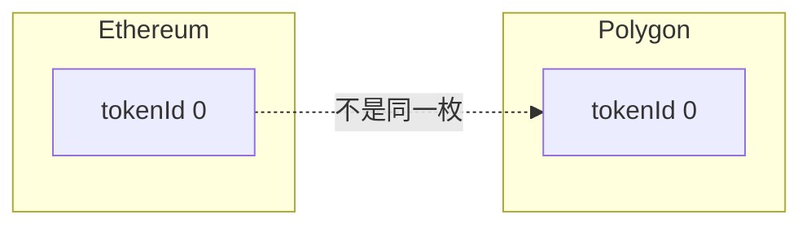
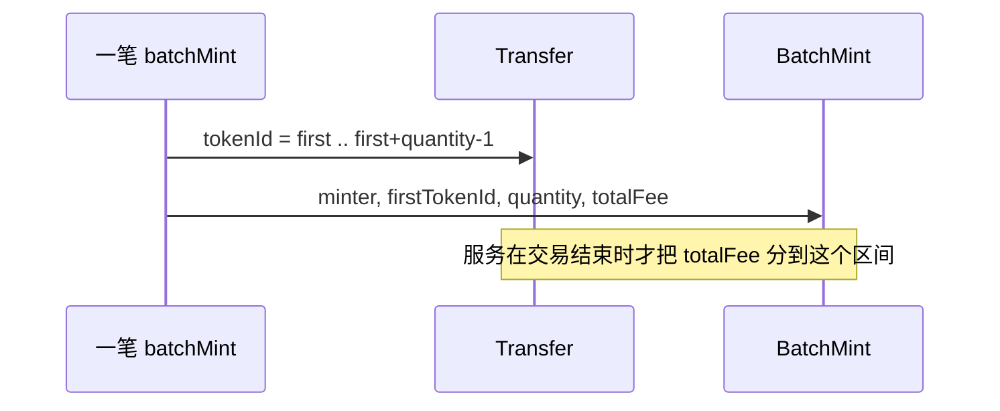
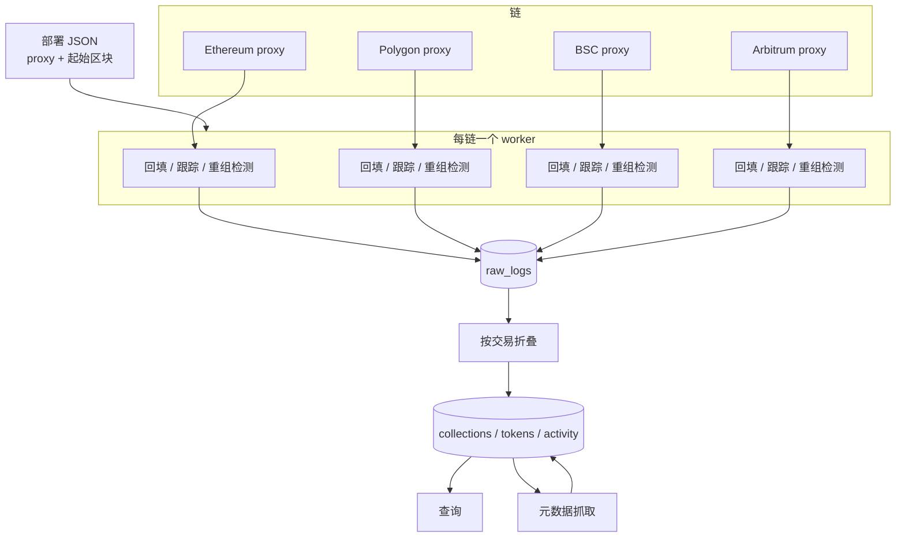
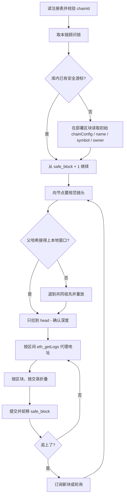
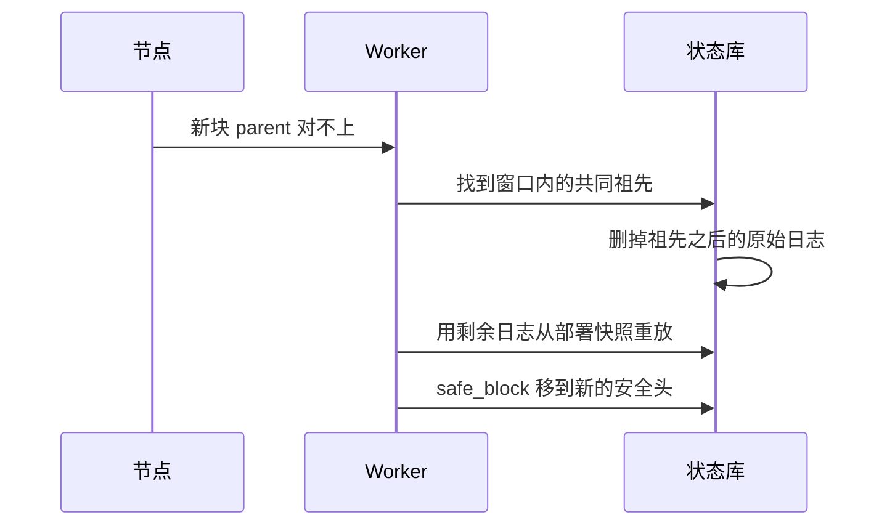

# Universal NFT 多链数据同步服务

日期：2026-10-20

同一份 [`UniversalNFTCollection`](../src/multichain_nft/UniversalNFTCollection.sol) 用透明代理部署到多条链。每条链有自己的 `ChainConfig`、自己的 `tokenId` 序列和自己的手续费余额。链与链之间没有消息传递，也没有跨链锁定或铸造。

同步服务要做的事只有一件：把各链代理上的日志折成一份可查询的读模型，让「这个地址在哪些链上持有哪些代币、每条链现在怎么收费」一次查完。它不发起交易，不搬代币，也不把不同链上的同号 `tokenId` 当成同一枚资产。

合约与部署入口：

- 合约：[`src/multichain_nft/UniversalNFTCollection.sol`](../src/multichain_nft/UniversalNFTCollection.sol)
- 单链脚本：[`script/multichain_nft/DeployUniversalNFT.s.sol`](../script/multichain_nft/DeployUniversalNFT.s.sol)
- 多链循环：[`script/multichain_nft/deploy-multichain.sh`](../script/multichain_nft/deploy-multichain.sh)

`deploy-multichain.sh` 在广播后写出 `deployments/multi-chain-summary.json`。每条链更完整的记录在 `deployments/UniversalNFTCollection/UniversalNFTCollection_<chainId>.json`，里面有 `address`、`chainId`、`blockNumber`、`deployer`。回填起点用这份文件的 `blockNumber`，摘要文件里没有起始区块。

---

## 边界

| 做 | 不做 |
| --- | --- |
| 按代理地址订阅并回放日志 | 跨链桥、锁定、销毁后再铸造 |
| 维护持有人、手续费配置、铸造流水的当前状态 | 代替合约做铸造或提现 |
| 重组时把读模型退回到共同祖先再重放 | 把各链 `tokenId` 合并成全局序号 |
| 暴露按地址、按链、按代币的查询 | 在索引路径里等待 IPFS 或 HTTP 元数据 |

同一枚资产的身份是三元组 `(chainId, proxy, tokenId)`。Polygon 上的 0 号和 Ethereum 上的 0 号是两枚代币。

---

## 链上事实

这些事实决定了同步怎么写。它们都来自当前合约，升级改了事件或存储之后要重新核对。

**日志都出在代理地址上。** 业务函数通过 `delegatecall` 进实现合约，`Minted`、`Transfer` 的 `log.address` 仍是代理。升级和更换 admin 也在代理上下文里发出 `Upgraded`、`AdminChanged`。过滤器只钉代理地址，不要去扫实现合约。实现合约的初始化已被关掉，上面没有用户状态。

**单枚和批量的事件不对称。** `mint` 对每枚代币发一条 `Minted`。`batchMint` 只发一条 `BatchMint(minter, firstTokenId, quantity, totalFee)`，范围内每枚代币另有一条 ERC-721 `Transfer`。供应量和持有人以 `Transfer` 为准，手续费和批量铸造人挂在 `Minted` / `BatchMint` 上。两条路都要接，不能只听其中一种。

**同一笔交易里，`Transfer` 先于收费事件。** `_mintNext` 在 `emit Minted` / `emit BatchMint` 之前就 `_safeMint`。按 log index 逐条折叠时，看到 mint 转账还不知道手续费。必须以交易为原子单位：先收齐该交易里这个代理的全部日志，再写代币行。

批量里每枚的手续费是 `totalFee / quantity`。合约里 `totalFee = baseFee * count`，能整除。不能整除说明日志和当前 ABI 不一致，这条链标成降级，停止前移游标。

**初始化不发 `ChainConfigUpdated`。** `initialize` 直接写入 `chainConfig`，只有后来的 `setFeeConfig` 才发 `ChainConfigUpdated`。`name`、`symbol` 同样没有事件。起始状态靠在部署区块上读 `chainConfig()`、`name()`、`symbol()`、`baseURI()`、`owner()`、`nextTokenId()`。`OwnershipTransferred` 在 `__Ownable_init` 时会发，可以和这次读取互相核对。

**`chainId` 初始化后不变。** `setFeeConfig` 会复用已绑定的 `chainId`。事件里的 `chainId` 必须等于注册表里的链。不一致就停这条链，避免把 Polygon 的配置写进别的链的行。

**元数据事件不带 URI 字符串。** `setBaseURI` 发 `BatchMetadataUpdate(0, type(uint256).max)`。`setTokenURI` 经 ERC-721 URI Storage 发 `MetadataUpdate(tokenId)`。新的 URI 要用对应区块上的 `baseURI()` / `tokenURI(tokenId)` 读出来。

**当前合约没有 burn，也没有 `receive`。** 从零地址转入表示铸造，没有转出到零地址的路径。合约余额应等于已收取手续费减去 `FeesWithdrawn`。有人用自毁往里打钱，或以后的升级加上 `receive`，这条等式会失效，校验只能报警，不能据此改写流水。

部署脚本里的链画像，同步注册表按同一组 chainId 建档：

| 网络 | chainId | baseFee | maxBatchSize | supportsBatch |
| --- | --- | --- | --- | --- |
| Ethereum | 1 | 0.01 ether | 10 | 否 |
| Polygon | 137 | 0.001 ether | 100 | 是 |
| BSC | 56 | 0.001 ether | 50 | 是 |
| Arbitrum | 42161 | 0.001 ether | 20 | 是 |
| Anvil | 31337 | 0.001 ether | 20 | 是 |
| Sepolia | 11155111 | 0.0001 ether | 10 | 是 |
| BSC testnet | 97 | 0.0001 ether | 50 | 是 |

表里的费率只是部署时的初值。之后以 `ChainConfigUpdated` 为准。

---

## 总体结构

一条链一个 worker。worker 之间不共享游标、不共享 RPC 连接。一条链的节点超时只让自己的游标停住。

原始日志先落库，当前状态是它的折叠结果。重组或修数据时从库内日志重放，不依赖节点还能返回几个月前的 `eth_getLogs`。

进程模型用一个进程加每链一个循环即可。每条链在库里拿一把按 `chain_id` 的顾问锁，避免两个进程同时前移同一条游标。

---

## 组件

**注册表。** 启动时读 `deployments/UniversalNFTCollection/UniversalNFTCollection_<chainId>.json`，得到代理和 `blockNumber`。实现地址、ProxyAdmin 从对应的 `UniversalNFTCollection_Implementation_*`、`UniversalNFTCollection_ProxyAdmin_*` 读入，只做对照。RPC 与确认深度放在服务自己的配置里，不写进合约仓库的 `.env` 私钥段。

启动校验：

1. `eth_chainId` 等于文件里的 `chainId`。
2. 代理上有代码。
3. `eth_getCode` 看到的实现地址与部署文件一致；不一致时若库里已有 `Upgraded`，以日志为准，否则停机等人确认。
4. 调用 `chainConfig()`，返回的 `chainId` 等于这条链。

**原始日志库。** 一行一条日志。主键 `(chain_id, block_hash, log_index)`。同时存 `block_number`、`tx_hash`、`tx_index`、`topic0` 和未解码的 data。已见过的主键直接跳过。

**折叠器。** 只消费「已确认且父哈希能接上」的区块。一个区块里按 `tx_index`、再按 `log_index` 分组。一组日志进一个数据库事务：写原始行、更新代币和集合、前移这条链的游标。事务失败则这一整个区块都不算处理过。

**元数据抓取。** 独立队列。链同步只把代币标成 `uri_stale`，不等待 IPFS。

**查询。** 只读已确认状态。调用方要看尚未达到确认深度的头部时，走单独的 `latest` 视图，响应里带上 `provisional: true`。

---

## 存储

下面是逻辑模型，不是建表语句。

### 链与游标

`chains`：`chain_id`，网络名，代理，当前实现地址，部署区块，确认深度，原生币符号。

`sync_cursors`：每链一行。`safe_block` 是已经折叠进状态、且达到确认深度的高度。`safe_hash` 是这个高度的区块哈希。`head_block` 只用于观测滞后，不参与查询。

游标只能沿规范链连续前进。中间有空洞就不许从空洞后面开始折叠。

### 区块窗口

`blocks`：`chain_id`，`number`，`hash`，`parent_hash`，`timestamp`。至少保留「确认深度 + 重组回退余量」这么多块。更早的区块哈希可以丢，原始日志仍留着。

### 集合当前状态

`collections`：每链一行。

- `name`，`symbol`，`base_uri`
- `base_fee`，`max_batch_size`，`supports_batch`，`fee_recipient`，配置绑定的 `chain_id`
- `owner`
- `next_token_id`
- `implementation`
- `updated_block`，`updated_log_index`

### 代币

`tokens`：主键 `(chain_id, token_id)`。

- `owner`
- `minter`，`mint_tx`，`mint_block`，`mint_fee`
- `mint_kind`：`single` 或 `batch`
- `token_uri`，`uri_block`，`uri_stale`
- 可选的链下缓存：`metadata_name`，`image`，`fetched_at`，`fetch_error`

### 流水

`activity`：主键 `(chain_id, tx_hash, log_index)`。类型是 `mint`、`transfer`、`batch_mint`、`config`、`withdraw`、`metadata`、`upgrade`、`ownership`。查询动态和重放都用这张表。铸造在这里记两条来源时要能区分：`Transfer` 从零地址产生 `mint` 行，`Minted` / `BatchMint` 把手续费补到同一枚代币上，不另算一次供应量。

`raw_logs` 保留未解码原文。`activity` 是给人读的投影。

---

## 事件怎么落到状态

| 事件 | 来源 | 状态变化 |
| --- | --- | --- |
| `Transfer(from, to, tokenId)` 且 `from = 0` | ERC-721 | 插入代币，`owner = to`，`next_token_id` 至少推进到 `tokenId + 1` |
| `Transfer` 且 `from ≠ 0` | ERC-721 | 改 `owner`。当前 ABI 不会出现 `to = 0` |
| `Minted(to, tokenId, fee)` | 本合约 | 给该 `tokenId` 填 `minter = tx.from`，`mint_fee = fee`，`mint_kind = single`。`to` 必须和对应 `Transfer` 一致 |
| `BatchMint(minter, first, quantity, totalFee)` | 本合约 | 区间 `[first, first+quantity)` 内每枚填 `minter`、`mint_fee = totalFee / quantity`、`mint_kind = batch`。`minter` 必须等于 `tx.from` |
| `ChainConfigUpdated` | 本合约 | 覆盖集合的费率、批量上限、`fee_recipient`。事件里的 `chainId` 必须等于本链 |
| `FeesWithdrawn(recipient, amount)` | 本合约 | 记一条提现流水。不改代币 |
| `OwnershipTransferred` | Ownable | 改集合 `owner` |
| `MetadataUpdate(tokenId)` | URI Storage | 该代币 `uri_stale = true` |
| `BatchMetadataUpdate` | `setBaseURI` | 集合级标记，全部代币 `uri_stale = true` |
| `Upgraded(implementation)` | ERC-1967 | 更新 `collections.implementation`，链状态改为「待人工确认 ABI」 |
| `AdminChanged` | ERC-1967 | 只记流水，供和部署文件里的 ProxyAdmin 对照 |

`Minted.to` 与 `Transfer.to` 不一致，或批量区间里缺了某次零地址 `Transfer`，都是硬错误：回滚这个区块的事务，游标停住，打出 `(chain_id, tx_hash)`。

`next_token_id` 不直接相信事件里的最大值就算完。处理完一个已确认区块后，它必须等于「零地址 `Transfer` 的条数」。合约的 `tokenId` 从 0 连续递增，缺号同样是硬错误。

---

## 同步流程

### 回填

起点是部署文件里的 `blockNumber`。若库里 `safe_block` 已经更高，从 `safe_block + 1` 开始。

`eth_getLogs` 的地址过滤就是代理。这个合约的日志量远小于整链，不按 topic 拆请求，避免漏掉升级后新增的事件。未知 `topic0` 照样进 `raw_logs`，折叠器不认识就只记一条 `unknown` 流水，不丢数据。

区间大小从 2,000 个区块开始。节点返回范围过大或超时，区间减半，最小 100。连续成功再慢慢放大，上限 10,000。减半和放大都按链单独记，Polygon 的公共节点限流不要拖累 Ethereum。

折叠到部署区块时，先写入那一次 `eth_call` 得到的初始配置，再应用该块日志。这样后面的 `ChainConfigUpdated` 才是增量。

### 跟踪

追上安全头之后，优先用 WebSocket 的新块通知，断线就退回轮询。轮询间隔按出块时间：Ethereum 12 秒，Polygon 约 2 秒，BSC 约 3 秒，Arbitrum 约 0.25 秒，本地 Anvil 1 秒。通知只负责叫醒 worker，真正的日志仍用 `eth_getLogs` 按区块区间拉，避免订阅漏消息无法补洞。

### 确认深度

查询默认只看安全头。深度是「这条链上，这个高度之后还可能改写」的工程判断，不是合约参数。

| 网络 | 安全确认 | 原因 |
| --- | --- | --- |
| Ethereum、Sepolia | 64 个区块，或节点的 `finalized` | 对齐信标链最终性量级 |
| Polygon | 128 个区块，或 `finalized` | 历史重组比主网深 |
| BSC、BSC testnet | 15 个区块 | 较快最终性，仍留一段可回退窗口 |
| Arbitrum | 软确认 10 个 L2 块进 `latest`；安全头等节点 `safe` | 排序器先给软确认，真正稳定要等 L1 批次 |
| Anvil | 0 | 本地链；若创世哈希变了，整链清空重来 |

节点支持 `finalized` / `safe` 时，用这两个标签计算安全头，深度表只作标签不可用时的退路。`latest` 视图可以展示还没到安全头的铸造，响应里标明尚未确认。

### 重组

每来一个新块，用本地窗口检查 `parent_hash`。对不上就沿窗口向前找共同祖先：

1. 数据库事务内，删掉高度大于共同祖先的 `blocks`、`raw_logs`、`activity`。
2. 代币和集合不在事务里逐条撤销。直接从部署区块的初始快照，用仍留在库里的 `raw_logs` 重放到新的安全头。原始日志是规范，状态表是缓存。
3. 重放完成后再把 `safe_block` 设到新的安全头。

窗口不够长、找不到共同祖先时，不猜测。这条链标记为需要全量重放，从部署区块再来一遍。Anvil 重置属于这种情况：高度回到早期，且创世哈希变了。

重放必须和在线折叠用同一段逻辑。两套解析会在重组后算出另一套持有人。

---

## 元数据

链同步和元数据抓取分开，是为了 IPFS 慢或网关 404 时游标仍能前进。

1. 折叠器看到 `MetadataUpdate` 或 `BatchMetadataUpdate`，只把受影响的代币标成 `uri_stale`。
2. 抓取器在该事件所在区块上调用 `tokenURI`。`BatchMetadataUpdate` 的范围是全体时，先读一次 `baseURI()`，再按代币读 `tokenURI`。读到的字符串写回 `tokens.token_uri`，并记下 `uri_block`。
3. 若 URI 是 `ipfs://`、`https://` 或 `data:`，再另一步取 JSON。失败写入 `fetch_error`，下次重试，退避上限一天。
4. 查询在 `uri_stale = true` 时仍返回上一版 URI，并带 `stale: true`。不要在请求路径里同步打 RPC。

`setBaseURI` 之后，没单独设过 URI 的代币会变成 `baseURI + tokenId`，设过的会变成 `baseURI + 自定义后缀`。事件分不出这两种，所以不能在本地用字符串拼接代替 `tokenURI()`。

---

## 升级

透明代理的 admin 不能调用 `mint`。同步服务用普通 RPC 账户只读，不持有 ProxyAdmin 的钥匙。

看到 `Upgraded`：

1. 记下新实现地址，链状态改为 `abi_hold`。
2. 安全游标停在升级区块之前。升级区块的业务日志先留在 `raw_logs`，不折叠。
3. 人工确认新实现的事件签名和存储仍兼容本文的事件表之后，把链状态改回 `running`，从停住的高度继续。

兼容的标准：本文表格里的事件名、indexed 参数布局没有变化，`tokenId` 仍然从 0 连续递增，`Transfer` 仍然代表持有权。新增事件可以，它们会先以 `unknown` 落库。改了 `Minted` 或 `BatchMint` 的字段顺序则不兼容。

---

## 一致性校验

校验按链定时跑，不阻塞折叠。失败只把链标成 `degraded` 并报警。自动修复的唯一动作是触发重放，不手改某一行持有人。

| 检查 | 期望 |
| --- | --- |
| `nextTokenId()` | 等于库里该链代币行数，也等于零地址 `Transfer` 条数 |
| 抽样 `ownerOf(tokenId)` | 等于 `tokens.owner` |
| `chainConfig()` | 等于 `collections` 里的费率字段 |
| `owner()` | 等于 `collections.owner` |
| `baseURI()` | 等于 `collections.base_uri` |
| 代理余额 | 等于 `sum(mint_fee) - sum(withdraw)`，仅作报警 |
| 批量交易 | 区间长度等于该交易里新增的零地址 `Transfer` 数 |

抽样按 `tokenId` 取模轮转，每天覆盖一遍已同步的代币。全量 `ownerOf` 只在 `degraded` 之后的修复里做。

---

## 查询

给前端和脚本用的读接口。默认 `view=safe`。

| 查询 | 行为 |
| --- | --- |
| 健康 | 每链返回 `head_block`、`safe_block`、滞后秒数、状态 `running` / `abi_hold` / `degraded`、最近一次错误 |
| 集合列表 | 每条已注册链的名称、符号、代理、费率、是否允许批量、`maxBatchSize`、`nextTokenId` |
| 地址组合 | 给定地址，跨链返回 `tokens.owner` 匹配的行。排序用区块时间，同一秒内按 `chain_id`、`log_index` |
| 单枚代币 | 路径里带 `chainId` 和 `tokenId`。返回持有人、铸造人、手续费、URI、是否过期 |
| 动态 | 可按链、地址、类型过滤 `activity` |
| 铸造报价 | 读该链当前 `base_fee`、`supports_batch`、`max_batch_size`，供界面决定能不能批量。这是索引里的配置，真正扣费仍以链上 `mintFee` 为准 |

跨链排序只用区块时间，接受几秒到几分钟的时钟偏差。响应里保留每条记录自己的 `chain_id` 和 `block_number`，不生成全局序号。

组合查询要分页。分页游标是 `(block_timestamp, chain_id, tx_hash, log_index)`，避免某一秒的多链铸造被翻页漏掉或重复。

---

## 运行与失败

配置按链列出：`chain_id`，RPC HTTP，可选 WebSocket，确认深度，回填起点（默认为部署区块）。代理地址以部署 JSON 为准，避免两处手写不一致。

| 情况 | 行为 |
| --- | --- |
| RPC 超时、限流 | 该链指数退避，其他链继续。区间减半 |
| WebSocket 断开 | 改轮询，重连后从 `safe_block + 1` 补洞 |
| 日志和 ABI 对不上 | 停游标，保留原始日志 |
| 实现升级 | `abi_hold`，等人确认 |
| 进程崩溃 | 事务没提交的区块会再处理。主键使重放无副作用 |
| 两个进程同时跑 | 顾问锁让第二个直接退出该链 |
| Anvil 被重置 | 创世对不上则清空该 `chain_id` 的日志和状态，从新部署区块再来 |

滞后超过该链 50 个确认深度时，健康接口标黄。查询仍返回最后一次安全状态，并带上 `lag_blocks`。

---

## 落地顺序

每一步都能单独验收，后一步不改前一步的事件语义。

**第一步，单链安全头。** 注册表、原始日志、`Transfer` + `Minted` + `BatchMint` 的折叠、代币表和游标。用本地 Anvil 部署后铸造、批量铸造，核对 `owner`、`next_token_id` 和手续费。确认深度设为 0。

**第二步，配置与提现。** 接上初始 `eth_call`、`ChainConfigUpdated`、`FeesWithdrawn`、`OwnershipTransferred`。改费后再铸造，索引里的 `base_fee` 和链上 `mint` 扣费一致。

**第三步，重组。** 在 Anvil 上挖几块、铸造、再把头部回滚。安全头退回共同祖先，持有人与被丢掉的分叉无关。这一步没过，不要接公共测试网。

**第四步，多链并行。** Sepolia 与 BSC testnet 各起一个 worker。同一地址在两条链上的代币分两行返回。停掉其中一个 RPC，另一条链的游标仍前进。

**第五步，元数据与升级暂停。** `setBaseURI`、`setTokenURI` 只把 URI 标脏，游标不等网关。模拟 `Upgraded` 后，该链停在升级块之前，另一条链不受影响。

**第六步，校验与健康接口。** 打开抽样 `ownerOf` 和余额等式报警。健康接口能看出滞后和 `abi_hold`。

---

## 验收

一条链算同步完成，当且仅当：

- 从部署区块到安全头，原始日志连续，没有未解释的空洞。
- `nextTokenId()`、抽样 `ownerOf`、`chainConfig()` 与库一致。
- 一笔 `batchMint` 在库里对应 `quantity` 枚代币，手续费之和等于 `totalFee`，且只有一条批量流水。
- 重组演练后，被回滚的 `tokenId` 不再出现在安全查询里。
- 查询同一个地址时，每条记录都带 `chainId`，同号 `tokenId` 不会并成一行。
