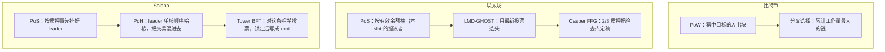
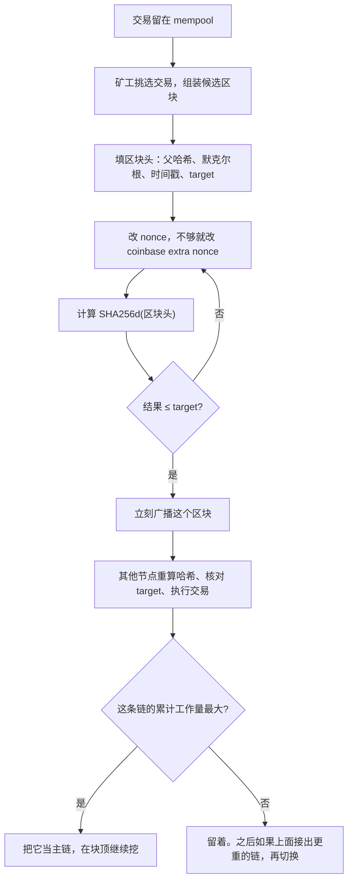
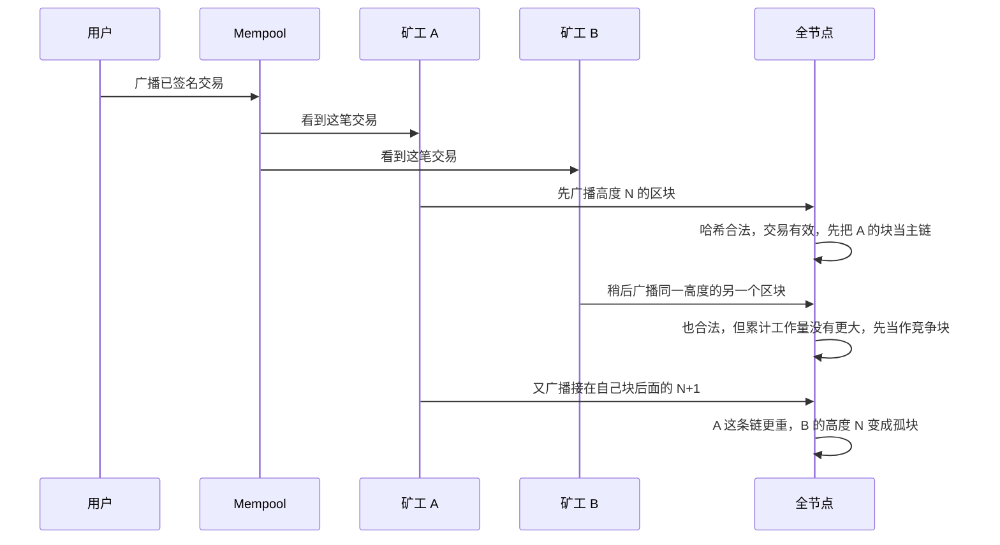
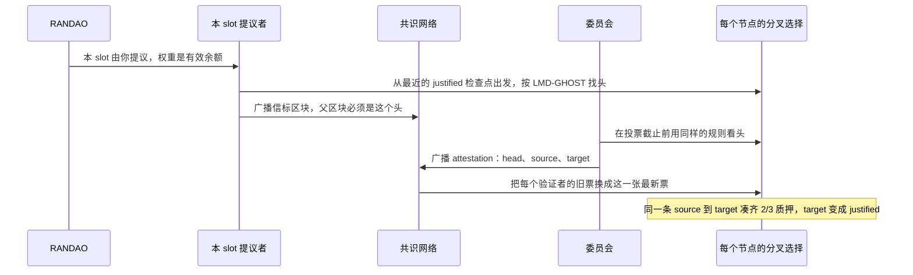
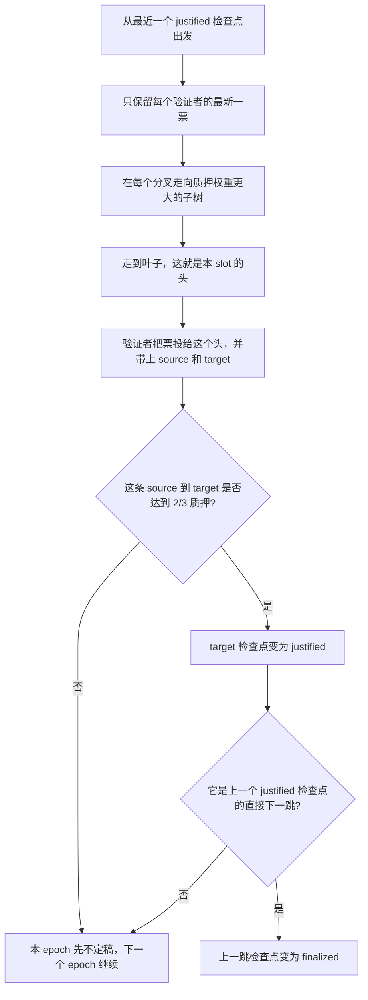
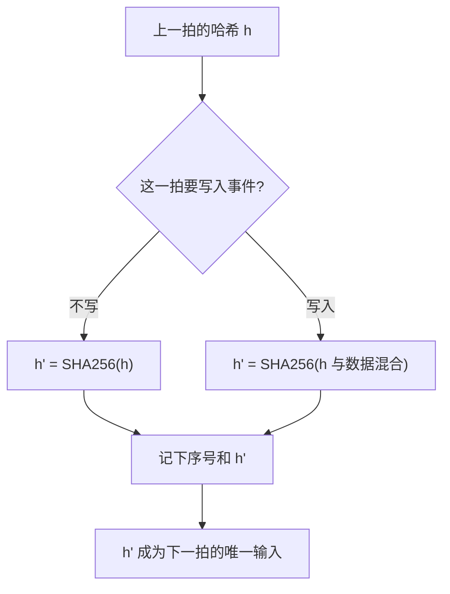
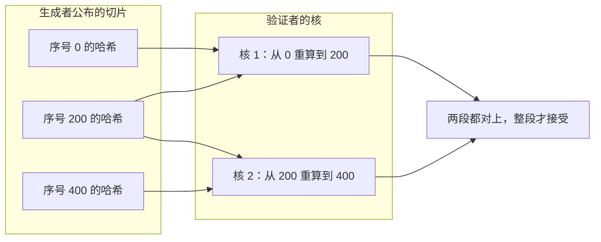
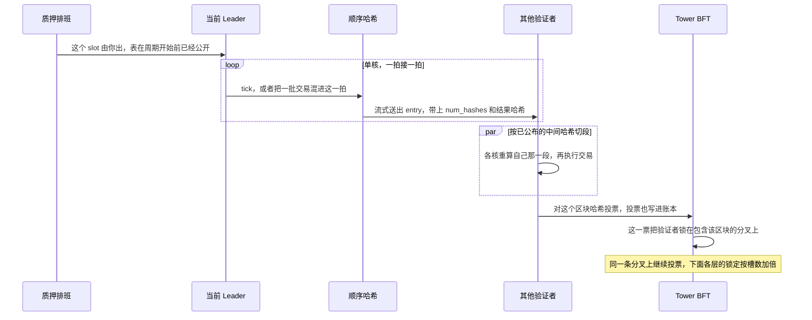

# PoW、PoS、PoH：抽签、投票、时钟

这三个缩写经常被放在一起叫「共识算法」。它们回答的不是同一个问题。

PoW 和 PoS 决定谁有资格追加下一块，以及别人该跟哪条分叉。PoH 不选人，也不投票。它是一条必须按顺序算出来的哈希链，用来证明两件事之间至少过去了多少计算，从而给事件一个改不掉的先后。

Solana 把三件事叠在一起：PoS 排班选出 leader，PoH 给这个 leader 的输出盖上顺序，Tower BFT 让验证者对这条顺序投票。只说「Solana 用 PoH」会把时钟说成共识。

| | 它回答的问题 | 谁在用 |
| --- | --- | --- |
| PoW | 谁先交出足够的工作量；哪条链的累计工作更重 | 比特币。以太坊在 2022-09-15 合并前也是 |
| PoS | 谁的质押被抽中来提议；投票如何把检查点定死 | 以太坊现在的 Gasper |
| PoH | 这段数据是在第几次哈希之前、之后被写进去的 | Solana 的时钟。出块权和定稿在 PoH 外面 |

参考：[Bitcoin whitepaper](https://bitcoin.org/bitcoin.pdf)、[ethereum.org：Gasper](https://ethereum.org/developers/docs/consensus-mechanisms/pos/gasper/)、[Gasper 论文](https://arxiv.org/abs/2003.03052)、[Solana whitepaper](https://solana.com/solana-whitepaper.pdf)、[Proof of History](https://solana.com/news/proof-of-history--a-clock-for-blockchain)、[Tower BFT（Agave）](https://docs.anza.xyz/implemented-proposals/tower-bft)。

---

## 三套东西叠在系统里的位置



---

## PoW：工作量既是抽签，也是链的重量

比特币的规则可以收成一句：区块头的双重 SHA-256 不大于当前 target，这个区块才算挖出来；节点跟累计工作量最大的那条链。

### 一个区块怎样才算挖到

区块头 80 字节，里面和挖矿有关的是父区块哈希、交易默克尔根、时间戳、压缩过的 target（`bits`）、32 位 `nonce`。

矿工反复改 `nonce`，计算：

```text
hash = SHA256(SHA256(header))
合法 ⟺ 把 hash 当成整数 ≤ target
```

`nonce` 只有 32 位，算力够大时一轮就穷举完。矿工再改 coinbase 交易里的 extra nonce。coinbase 一变，默克尔根跟着变，等于换了一批新的区块头。搜索空间因此不只有 2^32。

没碰上 target 的哈希直接丢掉。算到一半没有「进度」可以保存或转让。期望尝试次数和 target 成反比，所以单位时间里谁的哈希多，谁中签的概率就高。这就是抽签。电费和矿机是这笔抽签的成本，也是伪造身份（Sybil）的成本：多开一个地址不会多一分算力。

难度大约每 2016 个区块重定一次，把平均出块拉回 10 分钟。实际用时相对两周偏离多少，target 就放宽或收紧多少，单次调整夹在 1/4 到 4 倍之间。

以太坊合并前用的是 Ethash，不是双重 SHA-256，出块大约 13 秒，分叉规则还会收叔块。骨架相同：哈希对上 target 才能出块，链的重量来自工作量。合并之后，执行层打包交易，出块权交给信标链的 PoS。

### 挖矿循环



### 两个矿工同时挖到时发生什么

同一高度可以短暂存在两个都合法的区块。节点先收到哪个就先放在主链上，后到的先摆在旁边。下一块接在哪边，哪边的累计工作量就更大。



分叉选择比的是累计工作量，不是区块个数。工作量大约是 `2^256 / target`：target 越小，这一块越重。难度调整很慢，所以大多数时候「更重」和「更长」是一回事。难度刚刚改过、两条链的 target 不同时，块数少的那条可以更重。

协议里没有「最终确认」这个状态。攻击者若私下维持一条更重的链，再一次性发布，公开的链会被换掉。算力不超过全网一半时，这条私链在期望上追不上已经公开、还在继续长的主链。交易所等 6 个区块，是自己定的风险习惯，不是协议常数。

---

## PoS：质押决定权重，投票分成两层

以太坊现在的共识叫 Gasper。它是两套规则：

- **LMD-GHOST** 每个 slot 选一次头。链可以继续长。
- **Casper FFG** 按 epoch 把检查点先标成 justified，再标成 finalized。finalized 之后，再出现一个冲突的 finalized 检查点，就意味着至少约 1/3 的质押触犯了罚没条件。

截至 2026-10 的主网配置，一个 slot 是 12 秒，一个 epoch 是 32 个 slot（6.4 分钟）。把 slot 改成 10 秒的 EIP-8198 还没有排期。

### 质押怎样变成出块权

验证者向存款合约存入 ETH，余额至少 32 ETH 才能激活。2025-05-07 的 Electra（Pectra）之后，开了复利提款凭证的验证者，有效余额上限是 2048 ETH；没开的仍然顶在 32 ETH。提议者和投票的权重都按有效余额算，不是按「一个验证者一票」等权。

每个 slot 至多一位提议者。抽签用的是 RANDAO：提议者交一份只有自己的密钥能产生的值，混进 `randao_mix`，后面的 slot 用这个 mix 加权抽样。提议者可以弃掉本 slot、不交出这个值，所以对未来的抽签有一位的影响。lookahead 把这种影响限制在很短的窗口里，不能凭这个随便指定以后谁出块。

没被抽中提议的验证者会被分进委员会，对本 slot 投票。投票是三元组：

| 字段 | 指什么 |
| --- | --- |
| head | 分叉选择认为的当前链头，给 LMD-GHOST 用 |
| source | 自己已经看到的 justified 检查点 |
| target | 本 epoch 的检查点，给 FFG 用 |

检查点是 epoch 边界上的那个区块。边界 slot 没人出块时，检查点落到更早的一个区块上，但 epoch 编号照走。

### 一个 slot 里谁先说话



提议者若按时出块，这张新块会在分叉选择里短暂加权（proposer boost）。同一 slot 里后到的竞争块不容易把先到的合法块挤掉。

### 选头和定稿是两条规则



创世检查点从一开始就是 justified。之后：

1. 一条从已 justified 检查点指向目标检查点的链接，拿到不少于 2/3 总质押，目标就 justified。
2. 一个 justified 检查点如果连到它的直接子检查点，它自己就 finalized。

网络正常时，epoch N 的检查点在这个 epoch 里被 justified；epoch N+1 被 justified 时，epoch N finalized。检查点本身的最终性大约是两个 epoch，12.8 分钟。一笔交易如果打在 epoch 中间，还要等自己所在 epoch 的检查点走完这段，所以从进块到协议最终性大约是两个到三个 epoch。进块仍然是一个 slot 的事。最终性慢，不代表交易要等 12 分钟才能被打包。

FFG 的安全界和活性界不一样。两个互相冲突的 finalized 检查点，意味着不少于约 1/3 的质押签了可以被罚没的票。反过来，超过约 1/3 的质押掉线或乱投票时，剩下的人凑不齐 2/3，最终性会停。停住 4 个 epoch 之后进入 inactivity leak：不投票的人余额持续被扣，直到还在投票的人重新超过 2/3。链在最终性停住的时候仍然按 LMD-GHOST 出块。

### 为什么投票必须能被罚没

PoW 里同时给两条分叉挖矿，要付两份电。早期只谈「用币龄抽签」、不罚没的 PoS 里，多投一票几乎不花钱。理性的验证者会给每条分叉都投票，分叉就不再收敛。这就是 nothing-at-stake。

以太坊把下面三件事写成罚没条件：

| 行为 | 判定 |
| --- | --- |
| 双重提议 | 同一个验证者在同一个 slot 签了两个不同的信标区块 |
| 双重投票 | 两张票的 target epoch 相同 |
| 包围投票 | 票 A 把票 B 包在中间：`A.source < B.source` 而且 `B.target < A.target` |

触发之后，验证者被扣掉一部分质押并逐出。同一时段被罚的人越多，罚得越重，用来让「凑齐 1/3 去制造两个 finalized」的成本随人数上升，而不是按人数线性相加。

### 长程攻击：退出之后钥匙还在

验证者提完款，旧钥匙下面已经没有可罚的质押。攻击者可以拿很久以前的钥匙，从创世另造一条历史。新节点如果只从创世往下验签名，两条历史都「签名有效」。

PoW 没有这个缺口。重写旧区块必须重做那些区块的工作量，已经烧掉的电收不回来。

PoS 用弱主观性补上：离线太久或第一次同步的节点，不从创世空推，而从一个还处在质押期内的 finalized 检查点起步。这个检查点可以来自客户端自带的默认值、自己上次在线时记下的根，或一个你愿意相信的同步源。已经退出的钥匙改不了这个检查点之后的历史，因为那段历史是当时还押着钱的人定的稿。

---

## PoH：顺序哈希是时钟，不是抽签

Solana 白皮书第 4 节的定义是：一段计算序列，用来密码学地验证两个事件之间过去了时间。

实现是单核上的 SHA-256。上一次输出当下一次输入，跑若干次后记下计数和当前输出。要把数据写进时间线，就把数据（或数据的哈希）混进这一拍的状态：

```text
只有时钟往前走:  h_i = SHA256(h_{i-1})
把事件写进去:    h_i = SHA256(h_{i-1} 与数据混合)
```

由此得到三个可以直接检查的事实：

- 数据出现在 `h_i` 的原像里，所以它在第 `i` 次哈希之前已经存在。否则这一拍的输出会对不上。
- 数据没出现在 `h_j`（`j < i`）里，所以在第 `j` 次时它还没被写进这条序列。
- `i - j` 是这两拍之间的哈希次数。每一步的输入是上一步的输出，不能并行、也不能从后面往前跳。

白皮书把它叫作高频可验证延迟函数，并写明这是宽松用法：验证时间约等于生成时间除以核数。密码学里的 VDF（Wesolowski、Pietrzak）会另附一条短证明，验证比重算快几个数量级。PoH 没有这条短证明。Solana 自己的 Tower BFT 说明里也是这么区分的。

### 生成必须串行



没有难度目标。每一次哈希都算数，不能丢掉一个自己不喜欢的结果再重来，除非从那一拍全部重算。重算会得到另一条哈希，和已经公布的那条对不上。

这也是它和 PoW 的分界。PoW 并行的是「很多人同时猜 nonce」，猜不中就扔。PoH 的生成者只有一条链，必须一拍一拍算。多核不能把同一次生成变快，因为第 `i` 拍的输入在第 `i-1` 拍算完之前不存在。

### 验证为什么可以并行

生成者把中间哈希一起公布。验证者按这些中间态把序列切开，每核重算一段。



只有起点和终点、没有中间态时，验证者也得顺序重算整段，墙钟时间和生成相同。并行来自分片后的重算，不是来自一条更短的证明。

已经公布的 `h_n` 也限制了篡改。想在 `h_n` 之前插进一笔交易，插入点之后的每一拍都会变，`h_n` 不再是原来的值。看过 `h_n` 的人不会接受这条改写。

PoH 挡不住另一件事：从很早的起点私下重算一整条替代历史。没有 target，算完的每一条链在哈希规则上都「合法」。这条假历史只是来得及算出来，不会自动变成主链。要变成主链，还得有质押权重的投票跟上去。

### 一个 slot：排班、哈希、投票

Leader 是 PoS 排出来的。一个周期的 leader 表按质押权重事先定好，节点在 slot 开始前就知道该听谁。PoH 不参与这次选择。

账本里的一条 entry 大致有三样：距上一条做了多少次哈希（`num_hashes`）、做完得到的哈希、这一拍混进去的交易。没有交易的 entry 是 tick，用来把 slot 切成等长的格子。子区块从父区块最后一个哈希接着算，所以父区块刚出现时，子区块还变不出来，中间那些哈希就是间隔的证明。

Leader 边算边把 entry 切成 shred 广播，不用等整个 slot 结束再发一个完整区块。



下一个 leader 接在最后一条被接受的哈希后面继续。某个 leader 没出块，排班表上的下一位接上一个还在的父区块，不能把缺失的哈希次数假装已经发生。

### Tower BFT 把超时换成 slot 数

经典 PBFT 靠墙上时钟的超时把诚实副本留在同一个 view，超时随失败指数变长。Tower BFT 用 PoH 已经数出来的 slot 代替这个时钟。投票是账本里的交易，时间是 PoH 计数，不是各节点本地钟对一次「我收到消息了」。

规则是一座投票塔：

1. 验证者给某个区块哈希投 `(公钥, 区块哈希)`。
2. 这一票要求：在锁定到期之前，下一票的祖先里必须还有这个区块。锁定按 slot 计。
3. 每往同一条分叉上再叠一票，塔里更老那些票的锁定就加倍。
4. 塔有深度上限。Agave 的说明按 32 层来写：堆满之后弹出最老的一票，对应的 slot 成为 root，节点不再回滚到它前面。弹出这一票也是发奖励的时机。
5. 最上面的锁定先到期时，这些过期的票从塔顶弹出。验证者可以从剩下的高度改投另一条分叉。

锁定没到期就去投一条不含该祖先的分叉，是应被罚没的行为。罚没证明是两张互相冲突的签名票。

这座塔偏向继续出块。锁过期了就可以换分叉，链不会因为凑不齐一张「最终」证书而停住。以太坊 FFG 相反：凑不齐 2/3 就停止最终性，再用 inactivity leak 把不投票的权重磨掉。

所以在 Solana 上要分开两个词。超级多数的投票是乐观确认。slot 变成 root，才是这个节点不再回滚的那一层。两件事都是 Tower 的投票结果。哈希次数只提供「这张票发生在第几拍」，不提供「这张票代表多少质押」。

---

## 对照

| | PoW（比特币） | PoS（以太坊 Gasper） | PoH（Solana 的时钟） |
| --- | --- | --- | --- |
| 角色 | 抽签，同时给链称重 | 用质押抽提议者，用投票定稿 | 给事件一个可复核的先后 |
| 谁能出下一块 | 谁先找到不大于 target 的哈希 | 本 slot 被 RANDAO 抽中的验证者 | 不决定。Leader 来自质押排班 |
| 权重 | 累计工作量 | 有效余额 | 没有权重 |
| 分叉 | 更重的链替换更轻的链 | LMD-GHOST 选头，FFG 定稿 | 不选分叉。Tower 对哈希投票 |
| 确认 | 概率性。6 个区块是惯例 | 检查点大约两个 epoch 后 finalized | 乐观确认看超级多数投票；root 看塔是否堆满 |
| 并行 | 猜 nonce 可以无限并行 | 委员会并行投票；一个 slot 一位提议者 | 生成不可并行；验证靠切开已公布的中间态 |
| 单独作恶的成本 | 电和矿机。重组要持续超过一半算力 | 罚没质押。两个冲突的 finalized 至少卷进约 1/3 | 另造一条哈希链很便宜。没人投票就不是主链 |
| 旧历史 | 重写必须重做工作量 | 退出后的钥匙靠弱主观性检查点挡住 | 从老起点重算做得到，仍然要过投票 |

---

## 读的时候容易混的三件事

**挖矿的并行和 PoH 的串行不是同一种并行。** PoW 是无数矿工同时试不同的 nonce，试错就丢。PoH 是同一个生成者必须使用上一次的输出。多核只帮助别人检查已经写下来的切片。

**质押买的是身份成本，PoH 没有这笔账。** 一万个密钥可以跑一万条哈希链。没有质押投票，它们都只是本地文件。

**「证明」要先问证明的是什么。** PoW 证明的是工作量，链的重量就是这些工作量之和。PoS 证明的是「这张票由还押着钱的密钥签过」，定稿来自 2/3 权重。PoH 证明的是顺序和时间下界。最终性始终来自叠在上面的那条投票规则：比特币没有协议内最终性，以太坊是 FFG，Solana 是 Tower 的 root。
