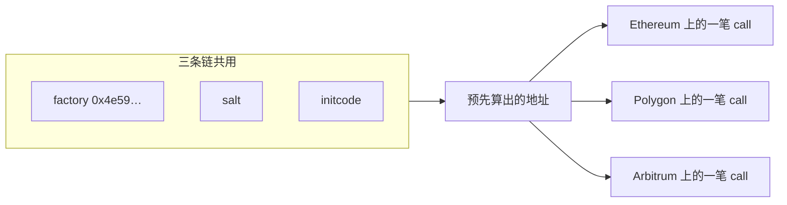

# 多链部署到同一个地址

日期：2026-10-20

同一个合约要在多条 EVM 链上落到同一个地址，就让地址公式里只出现各链相同的三项：已经同址的 factory、同一份 salt、同一份 initcode。每条链各发一笔交易去调用这个 factory。地址在广播之前就算得出来，和 chainId、签名人 nonce、哪条链先确认无关。

本仓库的现成入口是 [`script/CounterCreate2.s.sol`](../script/CounterCreate2.s.sol)。操作码公式见 [CREATE / CREATE2 / CREATE3](./create-create2-create3.md)。

```text
address = keccak256(0xff ++ factory ++ salt ++ keccak256(initcode))[12:]
initcode = creation bytecode || abi.encode(constructorArgs)
factory  = 0x4e59b44847b379578588920cA78FbF26c0B4956C
```



---

## 为什么普通部署对不齐

普通部署是 CREATE。地址是：

```text
address = keccak256(RLP([sender, nonce]))[12:]
```

同一个私钥在每条链上是不同的账户状态。Sepolia 上 nonce 可能是 40，Polygon 上可能是 3。签名里还有 EIP-155 的 `chainId`，这笔原始交易只能在它签名的那条链上被接受。所以同一把钥匙、同一份字节码，会得到一串不同的地址。

EOA 发出的创建交易（`to` 为空）只能是 CREATE。CREATE2 是合约里的操作码，调用方必须先有一个执行它的合约，而且这个合约在每条链上的地址得先相同。公式里的 `sender` 是这个 factory，不是付钱的 EOA。

---

## 三条链上已经同址的 factory

[Arachnid Deterministic Deployment Proxy](https://github.com/Arachnid/deterministic-deployment-proxy) 部署在：

```text
0x4e59b44847b379578588920cA78FbF26c0B4956C
```

Foundry 里的名字是 `CREATE2_FACTORY`（[`lib/forge-std/src/StdConstants.sol`](../lib/forge-std/src/StdConstants.sol)）。主网、多数 L2 和本仓库用的测试网都有它。它本身是用一笔不带 `chainId` 的原始交易放到这个地址上的，所以各链地址一致。

调用约定：calldata 是 `salt (32 字节) || initcode`，成功时返回 20 字节地址。同一 `(salt, initcode)` 只能成功一次。地址上已经有代码时，这次 CREATE2 失败。

部署前先确认这条链上真有代码：

```bash
cast code 0x4e59b44847b379578588920cA78FbF26c0B4956C --rpc-url sepolia
cast code 0x4e59b44847b379578588920cA78FbF26c0B4956C --rpc-url polygon
```

返回 `0x` 说明这条链还没有 factory，后面的同址部署没有落点。补部署的原始交易在上面的 Arachnid 仓库里；那笔交易的 gas 价格按主网时代写的，在 L2 上直接重放可能失败或很贵。先查这条链的文档或区块浏览器，确认 factory 是否已有人放好。

---

## 用本仓库的脚本部署

[`CounterCreate2Script`](../script/CounterCreate2.s.sol) 做四件事：

1. 要求 `CREATE2_FACTORY` 上有代码。
2. 用 `type(Counter).creationCode` 拼上构造参数 `20`，算出 initcode。
3. `vm.computeCreate2Address(salt, keccak256(initcode), CREATE2_FACTORY)` 得到地址。
4. 地址上还没有代码时，把 `salt || initcode` 发给 factory，并要求返回地址等于预测值。

salt 和构造参数写死在脚本里：

```solidity
bytes32 public constant SALT = keccak256("lbc-2026s3:Counter");
uint256 public constant INITIAL_NUMBER = 20;
```

每条链用同一份源码、同一个 Foundry profile 各广播一次。私钥只负责付 gas。换一把在该链上有余额的私钥，只要 factory、salt、initcode 不变，地址仍然相同。

```bash
cd bootcamp_2026_s3_vibe_coding_foundry
source .env

forge script script/CounterCreate2.s.sol:CounterCreate2Script \
  --rpc-url sepolia --broadcast --private-key "$SEPOLIA_PRIVATE_KEY" \
  && cat deployments/LATEST.txt

forge script script/CounterCreate2.s.sol:CounterCreate2Script \
  --rpc-url polygon --broadcast --private-key "$SEPOLIA_PRIVATE_KEY" \
  && cat deployments/LATEST.txt
```

第二条命令里的私钥换成在 Polygon 上有余额的那一把即可，不必和 Sepolia 是同一把。

`LATEST.txt` 每次广播会被覆盖，里面的 `chainId` 用来区分这次写的是哪条链。forge 收据里 CALL factory 的 “Contract Address” 是空的或指向 factory，创建出来的地址以脚本打出的 `Counter (CREATE2)` 和 `saveContract` 为准。

两条链都完成后，对同一个地址读代码和构造结果：

```bash
ADDR=0x预测或脚本打印出的地址
cast code "$ADDR" --rpc-url sepolia
cast code "$ADDR" --rpc-url polygon
cast call "$ADDR" "number()(uint256)" --rpc-url sepolia
cast call "$ADDR" "number()(uint256)" --rpc-url polygon
```

两份 `cast code` 相同，并且 `number()` 都是 `20`，这次同址部署就完成了。第二条链如果发现地址上已经有代码，脚本会直接接上已有合约。对同一 salt 和同一 initcode 再部署一次，CREATE2 会失败。

单测里的 `new Counter{salt: SALT}(0)` 不能拿来对这条地址。测试里执行 CREATE2 的 sender 是测试合约，广播时的 sender 是 `0x4e59…`，两边算出来的地址不同。脚本因此直接 `call` factory，而不写 `new Counter{salt:}`。Foundry 会把带 salt 的 `new` 改写成对 factory 的调用，这层改写在部分 L2（例如 OP Sepolia）上会偏离预测。

---

## 地址能相同的前提

| 必须各链相同 | 可以各链不同 |
| --- | --- |
| factory 地址 | 哪把私钥签名、它的 nonce |
| salt | 交易发出的时间、gas、区块 |
| solc 版本、optimizer、`via_ir`、`bytecode_hash`、`cbor_metadata` | `chainId` |
| 构造参数（含写进 `immutable` 的值） | 部署之后用交易写入的 storage |

本仓库 [`foundry.toml`](../foundry.toml) 的 default profile 关了 `via_ir`，optimizer 只在 `deploy` profile 里打开。一条链用 default、另一条链加 `--profile deploy`，initcode 的 hash 不同，地址就分开。全部链用同一次编译、同一个 profile。

构造函数里只要出现这条链特有的值，initcode 就变了。典型的是本链的价格预言机、本链的 WETH、本链的管理员地址、`block.chainid`。这些值放在部署之后的一次初始化里，构造参数保持各链一致。初始化交易改的是 storage，不改地址。

salt 是公开常量。知道 factory、salt 和 initcode 的人都能算出地址，也能抢先用同一份 initcode 部署到这个地址。抢先者部署的仍是这份字节码；换一份字节码会得到另一个地址。需要独占某个地址时，尽早在目标链上把这笔 CREATE2 发出去。

---

## 各链字节码或构造参数不同

CREATE2 把 initcode hash 写进地址。各链构造参数不同，地址就不同。这时用 CREATE3：factory 先用 CREATE2 部署一段固定的 proxy，proxy 再用 nonce 为 1 的 CREATE 部署真正的合约。最终地址只取决于 `(create3Factory, salt)`。

本仓库的 [`Create3Factory`](../src/Create3Factory.sol) 是 Solmate CREATE3 的薄封装。[`CounterCreate3.s.sol`](../script/CounterCreate3.s.sol) 里的 `new Create3Factory()` 是 CREATE。factory 地址跟着部署者在该链的 nonce 走，各链对不齐，后面的 Counter 地址也跟着散开。

要让 CREATE3 的结果跨链同址，顺序是：

1. 用上一节的 `0x4e59…` factory，以固定 salt 部署 `Create3Factory`。它的 initcode 各链相同，所以 factory 同址。
2. 在每条链上对这个 factory 调用 `deploy(salt, creationCode)`。`creationCode` 可以按链变化，对外地址不变。
3. 部署前用 `getDeployed(salt)` 核对，部署后要求返回值等于预测值。

同一 salt 在同一个 CREATE3 factory 上只能用一次。OpenZeppelin 的 Create3 和 Solmate 的 proxy 字节码不同，两边算出来的地址不能混用。本仓库走 Solmate。

各链 runtime code 不同时，地址相同只说明这个槽是同一套 salt 部署出来的。调用方仍要按 chainId 理解里面的配置。字节码这时不必逐字节相同。

---

## 用户调用的是代理时

用户看到的地址是代理地址。代理的 initcode 里只要嵌入了各链不同的实现地址或管理员，CREATE2 就会把代理部署到不同地址。

两条都能保住代理同址的做法：

- 实现合约也走 CREATE2，字节码各链相同，于是实现地址相同。代理构造参数因此也相同，代理再走一次 CREATE2。
- 代理构造参数里不放链相关地址，部署完成后再 `initialize`。或者走上面的 CREATE3，让代理地址脱离实现字节码。

EIP-1167 最小代理把实现地址写进自己的 runtime code。实现地址不同，clone 的 initcode 就不同，CREATE2 地址跟着变。

升级之后，各链的实现地址可以不再相同。同址约束只作用在部署那一次的 initcode 上，后面的升级交易改的是代理槽位里的指针。

---

## 广播前核对

1. 每条目标链上 `0x4e59…` 的 `cast code` 不是 `0x`。
2. 全程同一个 Foundry profile，中途不改 `foundry.toml` 的编译选项。
3. 构造参数是常量，没有 `block.chainid`，也没有某条链才有的地址。
4. 脚本里的预测地址和 factory 返回的地址一致；已有代码时读出来的状态符合这份构造参数。
5. 各链记录里的业务地址相同。收据上的 Contract Address 不拿来做这个比较。
