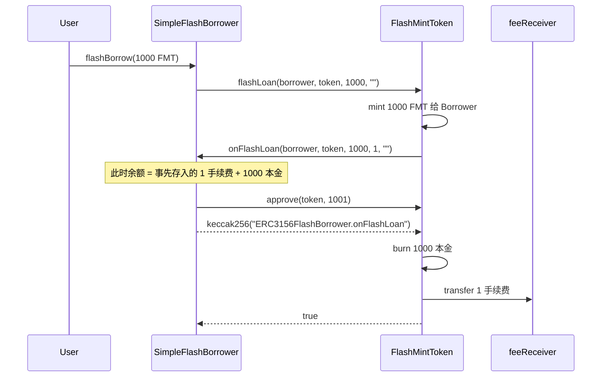

# ERC-3156 闪电贷 Demo

ERC-3156 规定同一笔交易里的单资产闪电贷接口：贷方先把代币交给借方，借方在回调里使用，然后授权贷方扣回本金加手续费。回调没按约定还款，整笔交易回滚，贷方不承担本金信用风险。

本目录用 OpenZeppelin [`ERC20FlashMint`](https://github.com/OpenZeppelin/openzeppelin-contracts/blob/master/contracts/token/ERC20/extensions/ERC20FlashMint.sol)（仓库里的 `lib/openzeppelin-contracts`，v5.7.0）做**闪电增发**：本金是临时铸出来的，不是从资金池里转出来的。

同仓库的 Uniswap V2 flash swap（`src/flash_swap/FlashSwapArbitrage.sol`）是另一套接口。它从交易对里转出现有储备，回调是 `uniswapV2Call`，还的是另一侧代币，靠恒定乘积校验。ERC-3156 还的是同一种代币加上 `flashFee`。

## 使用场景

借方在同一笔交易里拿到代币、用掉，再按本金加 `flashFee` 授权还回。交易结束时本金已经烧掉。借方能留下的，是用这些临时代币换到、并且还完款之后仍然剩下的其他资产。

**套利。** 铸出 FMT，在价格更高的市场卖掉，换成另一种资产；再到价格更低的市场买回不少于本金加手续费的 FMT，授权代币合约扣回。差价留在借款人地址上。`src/flash_swap` 从交易对借出已有储备，归还的是另一侧代币；这里借出的是临时 FMT，归还的是 FMT 加手续费。

**清算、偿还债务、更换抵押。** 用借到的代币先清偿一笔债务并取出抵押品，同一笔交易里卖掉抵押品，再买回足够的本币还贷。生产环境里的对应物是 MakerDAO 的 DAI 闪电增发（[DssFlash](https://docs.makerdao.com/smart-contract-modules/flash-mint-module)）：铸出 DAI，回调里使用，再拉回 DAI 加手续费并销毁。它可以用来清算保险库，或把金库抵押从一种资产换成另一种，调用方不必事先持有一整笔 DAI。

**看清铸造和销毁。** 本目录的 `SimpleFlashBorrower` 不交换、不清算。它在回调里记下余额和总供应，再 `approve` 本金加手续费，用来对照「铸出 1000、授权 1001、烧掉 1000」。给借款人准备那 1 FMT 手续费的 `mint` 只服务于本地演示。

回调进行时，同一笔交易里的其他合约读到的 `balanceOf` 和 `totalSupply` 含有这笔临时本金。抵押率、投票权和现货定价要读历史值，或读这笔交易结束之后的状态，见文末。

## 接口

贷方实现 `IERC3156FlashLender`：

| 函数 | 作用 |
|------|------|
| `maxFlashLoan(token)` | 这种代币最多能借多少。不支持就返回 0 |
| `flashFee(token, amount)` | 这笔借款要额外还多少。不支持的代币应当 revert |
| `flashLoan(receiver, token, amount, data)` | 把 `amount` 交给 `receiver`，并调用它的 `onFlashLoan` |

借方实现 `IERC3156FlashBorrower.onFlashLoan(initiator, token, amount, fee, data)`。返回值必须是

```text
keccak256("ERC3156FlashBorrower.onFlashLoan")
```

`initiator` 是调用 `flashLoan` 的地址，`msg.sender` 应当是贷方。`data` 由发起人传入，借方自己解码。



## 这个 demo 的两份合约

| 合约 | 角色 |
|------|------|
| [`FlashMintToken.sol`](./FlashMintToken.sol) | FMT。继承 `ERC20` + `ERC20FlashMint`，手续费 0.10%（`FEE_BPS = 10`），收款人在构造时固定 |
| [`SimpleFlashBorrower.sol`](./SimpleFlashBorrower.sol) | 借款人。`flashBorrow` 发起贷款，回调里记下当时的余额和总供应，再 `approve` 本金加手续费 |

OpenZeppelin 的默认实现是零手续费，手续费收款人是 `address(0)`，非零手续费会被烧掉。这里覆盖了两个内部函数：

- `_flashFee`：`amount * 10 / 10_000`
- `_flashFeeReceiver`：构造参数里的地址。手续费用 `transfer` 转走，不销毁

`flashLoan` 里实际发生的事：

1. `amount` 超过 `maxFlashLoan` 就 revert。本代币的上限是 `type(uint256).max - totalSupply()`，因为再铸就会溢出。
2. 把 `amount` **铸造**给 `receiver`。手续费不会被铸出来。
3. 调用 `onFlashLoan`。返回值不对就 revert。
4. `spendAllowance(receiver, token, amount + fee)`。借款人必须在回调里 `approve` 代币合约自己。
5. 烧掉 `amount`。手续费转给 `feeReceiver`。收款人若是 `address(0)`，OpenZeppelin 会把本金和手续费一起烧掉。

所以借款人在回调开始前就要持有手续费。这个 demo 用无权限的 `mint` 给借款人准备手续费，和闪电增发的本金不是一条路径。`mint` 只给本地测试和 anvil，不要部署到主网。

借 1000 FMT 时，手续费是 1 FMT。回调期间总供应比贷款前多 1000；交易结束后本金消失，总供应回到贷款前，那 1 FMT 在 `feeReceiver` 手里。金额太小、`amount * 10 / 10_000` 向下取整为 0 时，这笔贷款没有手续费。

## 借款人要检查的两件事

`onFlashLoan` 谁都能调用。`SimpleFlashBorrower` 做了两道检查：

- `msg.sender` 必须是构造时的 `lender`，避免伪造一笔“已经借到了”的回调。
- `initiator` 必须是借款人自己。否则别人可以直接调用 `token.flashLoan(borrower, ...)`，让借款人在回调里批准并付出自己的手续费余额。

`flashBorrow` 本身没有权限。谁调用，手续费都从借款合约的余额里扣。

## 本地测试

```bash
forge test --match-path test/erc-3156/FlashMint.t.sol -vv
```

覆盖：本金铸造后烧掉、0.10% 手续费进 treasury、回调中能看到临时余额和总供应、不支持的代币、超过 `maxFlashLoan`、手续费余额不够导致整笔回滚、第三方把借款人填进 `receiver` 时拒绝。

## 本地部署

```bash
forge script script/erc-3156/DeployFlashMint.s.sol:DeployFlashMint \
  --broadcast --rpc-url local \
  --private-key 0xac0974bec39a17e36ba4a6b4d238ff944bacb478cbed5efcae784d7bf4f2ff80 \
  && cat ./deployments/LATEST.txt
```

脚本部署 FMT 和借款人，给借款人 mint 1 FMT 手续费，再借 1000 FMT，并打印回调期间与结束后的供应和余额。anvil 默认私钥只用于本地。

## 和资金池闪电贷的差别

`ERC20FlashMint` 不需要池子里先有那么多余额，上限几乎是 `uint256` 能表示的剩余空间。借到的代币在同一笔交易里被烧掉，所以它改变不了交易结束后的总供应。它能改变的是回调**期间**读到的 `totalSupply` 和余额。

因此不要在回调路径上用这种代币的现货余额做抵押率、投票权或定价。同仓库的治理票用 `getPastVotes` 读历史区块，就是为了让同一笔交易里的临时余额影响不了投票。
