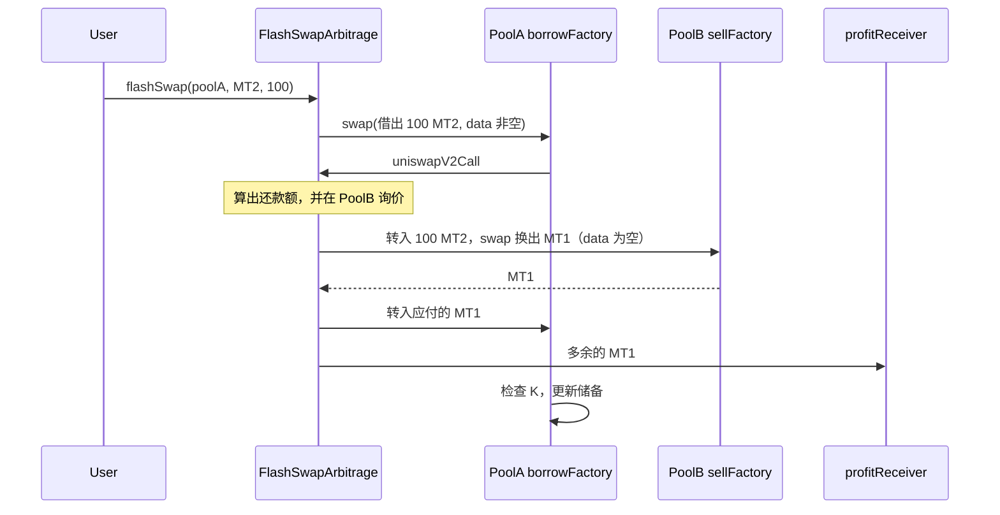

# 双池闪电兑换套利

这个目录做两件连在一起的事：从 Uniswap V2 交易对里**先拿走代币、同一笔交易里再还上**（flash swap），以及为什么这笔交易里读到的**现货价不能当定价**（TWAP）。

同仓库的 [ERC-3156 闪电贷](../erc-3156/README.md) 是另一套接口：借什么还什么，外加 `flashFee`。这里借的是交易对里已有的储备，回调是 `uniswapV2Call`，还的是**另一侧代币**，够不够由 Pair 的恒定乘积（含 0.3% 手续费）说了算。合约不经过 Router，直接调 `Pair.swap`。

## 四个合约

| 合约 | 作用 |
|---|---|
| [`MyToken1.sol`](./MyToken1.sol) / [`MyToken2.sol`](./MyToken2.sol) | 演示 ERC20（MT1 / MT2）。部署时给部署者铸造 1_000_000 枚，之后不能增发 |
| [`FlashSwapArbitrage.sol`](./FlashSwapArbitrage.sol) | 从 `borrowFactory` 的 pair 闪电借入，在 `sellFactory` 的对应 pair 卖掉，再还款；利润转给 `profitReceiver` |
| [`PoolATwapOracle.sol`](./PoolATwapOracle.sol) | 盯着 PoolA 的固定窗口 TWAP，仿 Uniswap `ExampleOracleSimple` |

两个 Factory 各自 `createPair`，得到两个地址不同的池。代币相同，价格可以不同。

## 价差从哪来

测试和 [`script/flash_swap/DeployFlashSwap.s.sol`](../../script/flash_swap/DeployFlashSwap.s.sol) 用同一组储备：

| 池 | 角色 | MT1 | MT2 | 现货（不计手续费） |
|---|---|---:|---:|---|
| PoolA | 借入侧，`borrowFactory` | 100_000 | 200_000 | 1 MT1 = 2 MT2 |
| PoolB | 卖出侧，`sellFactory` | 100_000 | 100_000 | 1 MT1 = 1 MT2 |

MT2 在 PoolA 更贵（换 1 个 MT2 要付更多 MT1）。从贵的池借出 MT2，到便宜的池换成 MT1，再用 MT1 还给贵的池，多出来的 MT1 就是利润。



## 学习路线

第一遍只读 [`FlashSwapArbitrage.sol`](./FlashSwapArbitrage.sol)。每一站只回答一个问题。

1. **方向写死在构造参数里。** `borrowFactory`、`sellFactory`、`profitReceiver` 部署后不变。利润永远打给 `profitReceiver`，调用 `flashSwap` 的人拿不到。
2. **入口只负责借。** `flashSwap(pair, borrowToken, amount)` 确认 `pair` 是 `borrowFactory` 按 `token0`/`token1` 算出来的那一个，然后 `swap`。`data` 用 `new bytes(1)`：长度大于 0，Pair 才会回调。
3. **回调先认人。** `uniswapV2Call` 要求 `sender == address(this)`，`msg.sender` 必须是借入侧那只 pair，并且 `amount0`、`amount1` 只有一边大于 0。
4. **还款额按借入池的精确输出来算。** `_arbAndRepay` 里 `getAmountsIn(borrowFactory, borrowAmount, [repayToken, borrowToken])`：想在 PoolA 留下 `borrowAmount` 个借入代币，至少要补进多少还款代币（含 0.3% 手续费，结果再加 1 wei）。
5. **卖出是另一只池上的普通 swap。** `getAmountsOut(sellFactory, …)` 询价；`amountReceived > amountRequired` 否则 `unprofitable`。把借入代币转进卖出 pair，`swap(..., new bytes(0))`。空 `data` 不会再套一层回调。
6. **先还款，再转利润。** 把 `amountRequired` 转回借入 pair，差额转给 `profitReceiver`，然后 `ArbitrageExecuted`。函数返回后，Pair 才做 K 检查。少还一分，整笔交易回滚，借出的币也回到池子里。

读完再看 [`UniswapV2Pair.swap`](../uniswapv2/UniswapV2Pair.sol)：先把 `amountOut` 转给 `to`，若 `data.length > 0` 就 `IUniswapV2Callee(to).uniswapV2Call(...)`，回来后用余额反推 `amountIn`，要求 `balanceAdjusted` 的乘积不低于旧的 `k`。闪电兑换没有单独的借款函数，就是这一次乐观转出。

## 一笔具体的账

借入 **100 MT2**（`100e18`）。两边都走恒定乘积，手续费是输入的 0.3%（`997/1000`）。下面按整数枚估算，链上还有截断和 `getAmountIn` 的 `+1` wei；精确值以测试日志为准。

**还给 PoolA。** 路径是 MT1 → MT2，要换出 100 MT2。不计手续费、也不计滑点时大约是 50 MT1（因为池子里 1 MT1 对应 2 MT2）。加上 0.3% 和一点点滑点后，大约 **50.18 MT1**。

**在 PoolB 卖掉。** 路径是 MT2 → MT1，投入 100 MT2。不计手续费时大约换回 100 MT1。扣掉手续费和滑点后，大约 **99.60 MT1**。

**利润**大约是 `99.60 − 50.18 ≈ 49.4 MT1`，全部是 MT1，打到 `profitReceiver`。套利合约自己在交易结束时两种代币余额都是 0。方向反了（从 PoolB 借、在 PoolA 卖）会 `unprofitable`：卖出所得盖不住还款。

`token0` / `token1` 由地址排序决定，不一定是 MT1、MT2。合约用 `borrowToken == token0` 选择 `swap(amount, 0, …)` 还是 `swap(0, amount, …)`，阅读时以「借入的那一边」为准，不要假设下标。

## 现货价挡不住这笔交易

同一笔交易里，攻击者可以先把池子价格砸偏，再按这个现货价成交，最后把价格换回来。闪电兑换让他不需要事先持有本金。所以 [`PoolATwapOracle.spotPrice1Per0`](./PoolATwapOracle.sol) 只适合对照，不能拿去清算或算抵押率。

TWAP 用 Pair 里已经在记的累计价：

```text
price0Cumulative += (reserve1 / reserve0) × 经过的秒数    // UQ112x112
TWAP              = (累计价_现在 − 累计价_上次) / 窗口秒数
```

`price0Average` 是 token1/token0，`price1Average` 是 token0/token1。`consult(token, amountIn)` 用对应均价换算另一侧数量：`amountOut = average × amountIn / 2^112`。`twapPrice1Per0` 把同一均价缩放到 1e18，方便和 `spotPrice1Per0` 比。

用法：

1. 构造时池子必须已有双边储备。合约抄下当时的 `price{0,1}CumulativeLast` 和 `blockTimestampLast`。
2. 任何人都可以 `update()`，但两次之间至少要过 `period` 秒，否则 `PERIOD_NOT_ELAPSED`。
3. 本块如果 Pair 还没 `sync`，`currentCumulativePrices` 会按当前储备把累计价补到 `block.timestamp`，和 Pair.`_update` 的算法相同。
4. `updated` 只表示至少成功刷新过一次。之后每隔 `period` 仍可以再刷。`consult` 和 `twapPrice1Per0` 在第一次 `update` 之前会 `NOT_UPDATED`。

窗口拉得太短，操纵成本就接近打一笔现货。窗口要盖住你愿意相信的那段时间；拿去定价时还要再对一下另一来源。预言机和套利合约没有互相调用：TWAP 用来说明「PoolA 的现货在一笔 swap 里可以被搬走」，套利用来说明这件事怎么发生。

## 怎么跑

```bash
forge test --match-path 'test/flash_swap/*' -vv
```

`FlashSwapArbitrage.t.sol` 打印借入量、还款额、PoolB 换回的 MT1 和利润。`PoolATwapOracle.t.sol` 在 1 小时窗口里分几次 `vm.warp` 做 swap，再比较 TWAP 和当时的现货。

本地链上部署两池、执行一次套利并打印前后储备：

```bash
forge script script/flash_swap/DeployFlashSwap.s.sol:DeployFlashSwap --broadcast --rpc-url local
```

私钥和 Anvil 账户写在脚本文件头注释里。
